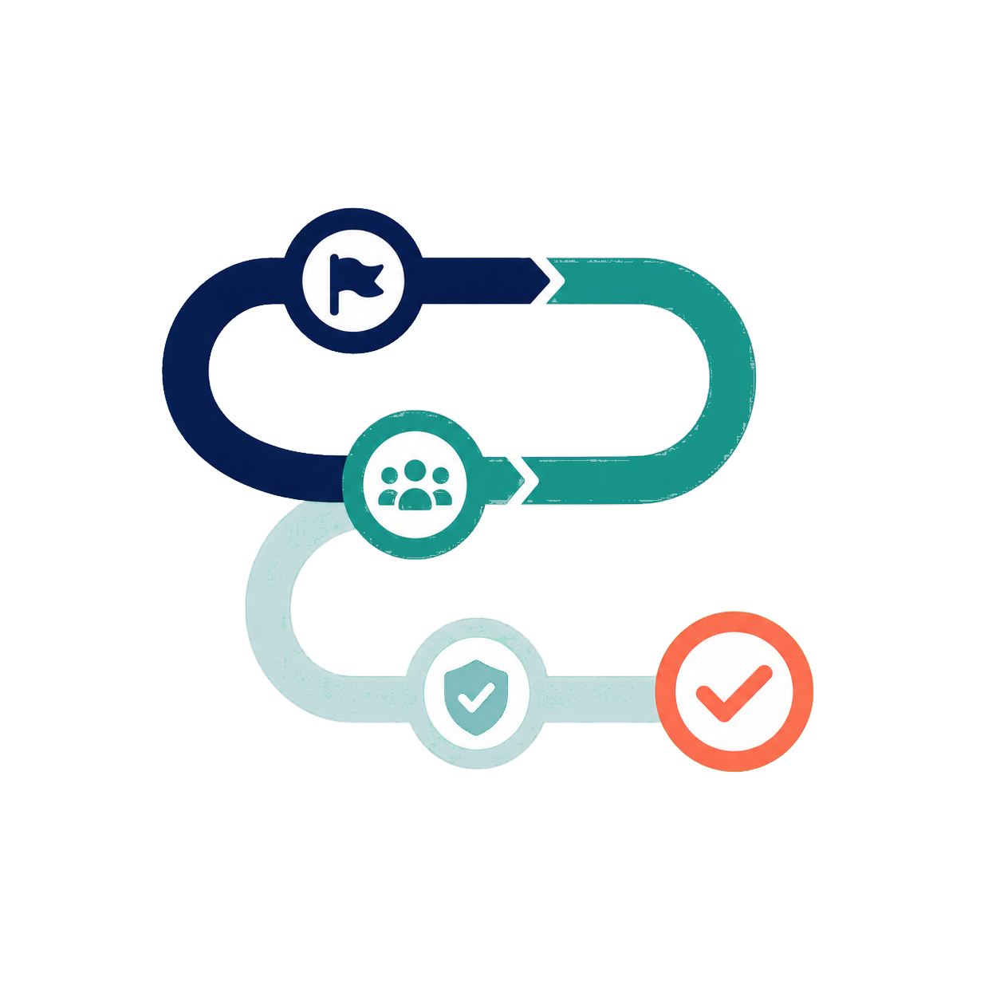
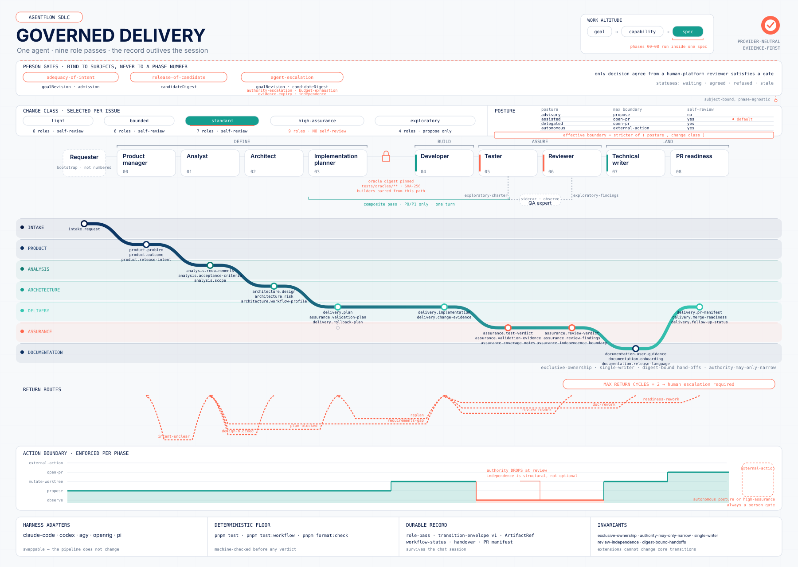

<div align="center">
  
  <br />
  
  <h1>AgentFlow SDLC</h1>
  <p><strong>Turn AI-assisted coding into reviewable, resumable software delivery.</strong></p>
  <p>
    <a href="LICENSE"></a>
    <a href="https://github.com/smota/agentflow-sdlc/stargazers"></a>
    <a href="https://github.com/smota/agentflow-sdlc/releases/latest"></a>
    <a href="https://github.com/smota/agentflow-sdlc/actions/workflows/validate-pr.yml"></a>
    
  </p>
</div>

AgentFlow SDLC is an open-source process layer for software projects that use AI coding agents. It
keeps requirements, decisions, validation, review, and handoffs in durable source records instead of
trapped in one chat session. GitHub is the first source adapter.

It adds delivery governance around your existing repository. It does **not** generate an
application, replace your source system or harness, or dictate your technology stack.

## The whole model in one picture



Read it in six passes:

- **Person gates float free of the pipeline.** The three gate classes bind to subjects — a goal
  revision, an admission, a candidate digest — never to a phase number. That is why the top rail has
  no lines running down into the columns.
- **Change class and posture are chosen per issue**, and the effective authority is the stricter of
  the two.
- **Nine role passes** carry one issue from intent to an evidence-backed pull request. One
  accountable executor wears each role in turn; `Requester` opens, `QA expert` rides alongside.
- **Seven evidence lanes** are kinds of record, not vendor tools. The baton weaves between them by
  who exclusively owns each namespace, which is why it enters delivery, leaves for assurance and
  documentation, and returns at PR readiness.
- **Eight return routes** run backwards underneath. Rework is a designed path, capped at two cycles
  before a person must step in.
- **Authority is enforced per phase and falls as well as rises.** It drops to read-only at test and
  review: independence is structural, not a convention.

The full specification — every rendered value, its citation in the source, and the render brief — is
in [the governance map specification](docs/diagrams/governance-map.md).

## Understand it in 30 seconds

| Question                        | Answer                                                                                                                                                                |
| ------------------------------- | --------------------------------------------------------------------------------------------------------------------------------------------------------------------- |
| **What is it?**                 | A role-based path from request to pull request, backed by templates, validators, and durable evidence.                                                                |
| **What problem does it solve?** | AI can produce code faster than teams can understand, review, resume, and govern the work around it.                                                                  |
| **What is the value?**          | Clear scope, reproducible checks, explicit review boundaries, safer handoffs, and less process memory.                                                                |
| **Who is it for?**              | Adopters, maintainers, provider authors, and operators who need reviewable AI-assisted delivery. Manual, CLI, and extensible provider bindings keep the core neutral. |

## Look without changing anything

```bash
# Run directly via npx or global install:
npx -y github:smota/agentflow-sdlc doctor-env --target /path/to/your-project

# Or install globally as an application:
npm install -g github:smota/agentflow-sdlc
agentflow-sdlc doctor-env --target /path/to/your-project
```

`doctor-env` reports on the target project's tooling; it does not change the target project. Ready
to continue? [Get started](docs/get-started.md) is the entry document — it reaches a first governed
change, a frozen acceptance contract with a recorded observation, in six commands. Prefer an
assistant to drive the same steps conversationally? Use the
[assisted onboarding guide](docs/assisted-onboarding.md) and
[assisted configuration guide](docs/assisted-configuration.md).

## Why you can trust it

Governance is only worth adopting if you can see it, tune it, and check it. Four properties carry
that weight.

### 1. Extensibility — nothing in the core is bound to a vendor

The core knows about roles, evidence, and authority. It does not know which model wrote the code.

- **5 harness adapters** in `adapters/`: `claude-code`, `codex`, `agy`, `openrig`, `pi`. Adapter
  files are distribution surfaces, not the source of product truth.
- **9 registered runtime platforms** name _who_ produced evidence. The execution target names _how_
  commands ran — `claude-cli` against `anthropic-api`, `codex-cli` against `provider-api`,
  `agy-cli` against `agy-session`, and so on. The two are never conflated and never inherited from
  whichever harness happened to launch the work.
- **Source-neutral core.** GitHub is the first read and mutation adapter, not an assumption.
- **3 extension packs** in `extensions/` add roles, gateways, paths, validators, and plays. What
  they may add is enumerated, and so is what they can never touch: extensions cannot change core
  transitions, role-pass provenance, the high-assurance human approval, readiness denominators, or
  the ban on raw secrets.

Start at [modular architecture](docs/modular-architecture.md),
[extension packs](docs/extension-packs.md), and
[runtime platforms](docs/runtime-platforms.md).

### 2. Parameters — the governance is configuration, not code

Risk appetite is a dial, and every dial has an enumerated range you can read before you adopt.

| Dial                | Values                                                                                                          | Effect                                                   |
| ------------------- | --------------------------------------------------------------------------------------------------------------- | -------------------------------------------------------- |
| Change class        | `light`, `bounded`, `standard`, `high-assurance`, `exploratory`                                                 | Which roles are required, whether self-review is allowed |
| Posture             | `advisory`, `assisted`, `delegated`, `autonomous`                                                               | Authority ceiling, self-review, budget ceiling           |
| Action boundary     | `observe`, `propose`, `mutate-worktree`, `open-pr`, `external-action`                                           | What a role may do; it may only ever narrow              |
| Collaboration mode  | `auto-minimal`, `single-agent`, `advisory`, `sparring`, `council`, `parallel-discovery`, `spike`, `human-gated` | How much extra intelligence joins a decision             |
| Council thresholds  | Domain counts, public-contract and migration triggers, seat list                                                | When a council convenes and who sits on it               |
| Bounded supervision | Max delegates, depth, iterations, rework rounds, stale timeouts                                                 | Nothing runs unbounded                                   |
| Branch strategy     | Trunk, integration, work prefixes, protected branches                                                           | Where implementation may and may not land                |
| Quota policy        | Observation windows, checkpoint cadence, fallback action                                                        | What happens when a provider runs out                    |

The effective authority for any step is the **stricter of posture and change class** — the rule most
often got wrong, and the reason both appear on the map. Defaults ship as `standard` and `assisted`.
Project values live in `agent-workflow.config.json` and `sdlc.config.json`, validated against
**60 JSON Schemas** in `schemas/`, with the machine configuration and the human definition document
named as separate authorities so neither can silently drift from the other.

See [project setup](docs/project-setup.md),
[execution distributions](docs/execution-distributions.md), and
[person gates](docs/person-gates.md).

### 3. Skills — eight skills with explicit, non-overlapping authority

Each skill in `skills/` declares what it owns and, just as importantly, what it must not do. The
separation of duties is in the contract, not in a convention.

| Skill                    | Owns                                                           | Must not                                                 |
| ------------------------ | -------------------------------------------------------------- | -------------------------------------------------------- |
| `agentflow-orchestrator` | Phase state, transition evidence, acceptance, PR readiness     | Author policy, migrate repositories, sign its own audit  |
| `agentflow-collaborator` | Complexity class, collaboration mode, council and helper scope | Own phase state, implement, or issue acceptance verdicts |
| `agentflow-scanner`      | Discovery scope, finding quality, evidence maps                | Issue verdicts, remediate, or widen scope silently       |
| `agentflow-designer`     | Canonical policy, roles, schemas, gates, extension contracts   | Apply adoption to consuming repositories, self-certify   |
| `agentflow-migrator`     | Adoption inventory, mutation planning, transactional apply     | Redefine policy, or mutate without preview and approval  |
| `agentflow-auditor`      | Validation selection, acceptance verification, the verdict     | Modify the audited subject, or waive human authority     |
| `agentflow-steerer`      | Advisory framing, grooming, dependency and trade-off reasoning | Implement, coordinate phases, or execute in-rig seats    |
| `agentflow-maintainer`   | Repository health, repair planning, rollback                   | Apply any mutation without explicit confirmation         |

Authority can only ever narrow as work is delegated, and a skill's proposal is never an approval.
Read [lifecycle roles](docs/roles/index.md) and
[role collaboration](docs/role-collaboration.md).

### 4. Deterministic tools — verdicts rest on machine checks

Judgement is reserved for the things that need it. Everything else is a check that either passes or
fails the same way on your machine and in CI.

- **29 validators** in `scripts/` cover issues, configuration, role passes, PRs, releases, skills,
  agents, roles, branch strategy, path ownership, evidence contracts, lifecycle contracts,
  collaboration evidence, the sparring gate, documentation integrity, and reachability.
- **One aggregate command.** `pnpm validate:release` chains format checks, the test suites, hook
  tests, workflow verification, distribution, authority, extensions, skills, roles, path ownership,
  documentation, reachability, evals, collaboration, package parity, and three smoke suites.
- **Path ownership is enforced, not advised.** Product-management seats write only `.agentflow/**`
  and `goals/**`. Steering seats write nothing at all. Builder seats cannot touch
  `tests/oracles/**`, and cannot start building until the oracle digest is pinned — so the thing
  being tested cannot be edited by the thing being tested.
- **Evidence is digest-bound.** Handovers and acceptance carry content digests, so a review
  attestation goes stale the moment the candidate changes rather than silently covering new code.

The deterministic floor every verdict stands on is `pnpm test`, `pnpm test:workflow`, and
`pnpm format:check`. See
[evidence contracts](docs/evidence-contracts.md) and the
[CLI and validation reference](docs/index.md#cli-and-validation-reference).

## Guiding principles

Six pillars govern the framework. Each has normative rules and a named manifestation in the
codebase; [guiding principles](docs/guiding-principles.md) carries the full set.

1. **Extensibility and harness neutrality.** Core SDLC logic is never coupled to a vendor session
   format or a proprietary engine.
2. **Regulated assurance and compliance-by-design.** Traceability and separation of duties are
   structural properties, not post-hoc paperwork. Tester and reviewer are read-only and never repair
   the code they assess.
3. **Risk-aware taxonomy and adaptive execution.** Proportional paths, with gates bypassed for light
   work and human sign-off required for high-assurance work.
4. **Agentic flow with human decision comprehension.** Gates present residual risk and verification
   receipts, so approval is meaningful rather than a rubber stamp.
5. **Durable continuity and portability.** Work and pipeline state are never trapped on one machine,
   one session, or one provider's quota.
6. **Bounded supervision and zero deadlock.** Every asynchronous gate resolves deterministically
   within a configured deadline, to an auditable status.

In practice that means: durable evidence over private chat memory; one accountable executor by
default and more intelligence only when it improves a decision; humans and agents following the same
public contribution contract; human authority for high-assurance work; and follow-up issues instead
of hidden TODOs.

## Choose your path

| I want to…                                | Read this                                                                                           |
| ----------------------------------------- | --------------------------------------------------------------------------------------------------- |
| Evaluate the product quickly              | [AgentFlow in 5 minutes](docs/agentflow-in-5-minutes.md)                                            |
| Adopt it in a repository                  | [Get started](docs/get-started.md)                                                                  |
| Find the right guide for my role          | [Start here](docs/start-here.md)                                                                    |
| Author or integrate an execution provider | [Provider author path](docs/providers/index.md)                                                     |
| Operate and troubleshoot an installation  | [Operator path](docs/operators/index.md)                                                            |
| Understand every document and tool        | [Documentation index](docs/index.md)                                                                |
| Configure branches, checks, and routing   | [Project setup](docs/project-setup.md) and [assisted configuration](docs/assisted-configuration.md) |
| Run or contribute issue work              | [Contribution workflow](docs/guides/contribution-workflow.md)                                       |
| Extend or integrate the framework         | [Modular architecture](docs/modular-architecture.md)                                                |

## What is available now

| Capability                                | What it provides                                                                           | Where to start                                              |
| ----------------------------------------- | ------------------------------------------------------------------------------------------ | ----------------------------------------------------------- |
| Preview-first adoption and updates        | Content-bound plan, transactional apply, lockfile v2, and external rollback receipt        | [Adopter path](docs/adopters/index.md)                      |
| Role-based delivery                       | Analyst through PR-readiness phases with explicit handoffs                                 | [Workflow](docs/agent-workflow.md)                          |
| Durable evidence                          | Portable artifact references, transition envelopes, lifecycle boundaries, and PR evidence  | [Evidence contracts](docs/evidence-contracts.md)            |
| Deterministic validation                  | Issue, config, role-pass, PR, release, skill, agent, evidence, lifecycle, and eval checks  | [CLI reference](docs/index.md#cli-and-validation-reference) |
| Intelligent collaboration                 | Provider-neutral intent plus bounded advisory, discovery, spike, and human-gated modes     | [Collaboration](docs/intelligent-collaboration.md)          |
| Role acceptance and councils              | Digest-bound handovers, deterministic checks, accountable acceptance, and bounded rework   | [Role collaboration](docs/role-collaboration.md)            |
| Providers and runtime identity            | Capability-based manual, CLI, Grok, and API facets with truthful attribution               | [Provider matrix](docs/providers/provider-matrix.md)        |
| Source adapters                           | Source-neutral core with GitHub as the first read/mutation adapter                         | [Source adapters](docs/sources/index.md)                    |
| Skills, plugins, settings, and extensions | Portable skills plus project-selected overlays and harness adapters                        | [Extension packs](docs/extension-packs.md)                  |
| Lifecycle roles and methods               | Productized accountability contracts with configurable analysis and engineering approaches | [Lifecycle roles](docs/roles/index.md)                      |
| Optional visual operations                | Cockpit goal, readiness, release, replay, approval, and follow-up views                    | [Cockpit](docs/cockpit.md)                                  |
| Executable quality model                  | Agent eval manifests, multi-agent acceptance checks, and derived outcome metrics           | [Agent evals](docs/agent-evals.md)                          |
| Maintained diagrams                       | Committed assets with the canonical values and render brief that produced them             | [Diagrams](docs/diagrams/index.md)                          |

## Release status

The current release line is **1.10.0** and requires Node.js 20 or newer. Read the
[release notes](docs/releases/v1.9.0.md) for the most recently documented capabilities and
qualification limits. No `agentflow-sdlc` package is currently published on npm, so install directly
from GitHub using npm as shown above; no manual clone is required. The release badge always resolves
to the newest published GitHub release.

## Repository layout

| Area               | Contents                                                                        |
| ------------------ | ------------------------------------------------------------------------------- |
| Policy             | `AGENTS.md` and executor adapters such as `CODEX.md`, `CLAUDE.md`, and `AGY.md` |
| Workflow           | `roles/`, `skills/`, and `agents/templates/`                                    |
| Documentation      | `docs/`, organized by audience in the [documentation index](docs/index.md)      |
| CLI and validators | `bin/`, `scripts/`, `lib/`, and `schemas/`                                      |
| Distribution       | `adapters/`, `skills/`, `extensions/`, and `manifests/`                         |
| Assets             | `assets/`, including maintained diagrams                                        |
| Optional interface | Cockpit assets and runtime commands                                             |

## Contributing

Start from a GitHub issue or explicit maintainer direction. Read [`AGENTS.md`](AGENTS.md) first,
then follow the [contribution workflow](docs/guides/contribution-workflow.md). Keep changes
issue-scoped, run the relevant validators, and use the project PR manifest.

## License

Licensed under the [Apache License 2.0](LICENSE).

## Delivery improvements in development

Candidate-bound observations, guarded run recovery, environment inspection and contained adoption
storage are documented in [reliable delivery](docs/reliable-delivery.md). Use
[run operations](docs/run-operations.md) for the CLI and
[release acceptance](docs/delivery-release-acceptance.md) for the remaining publication gates. These
development interfaces do not imply an npm 2.0 release.
