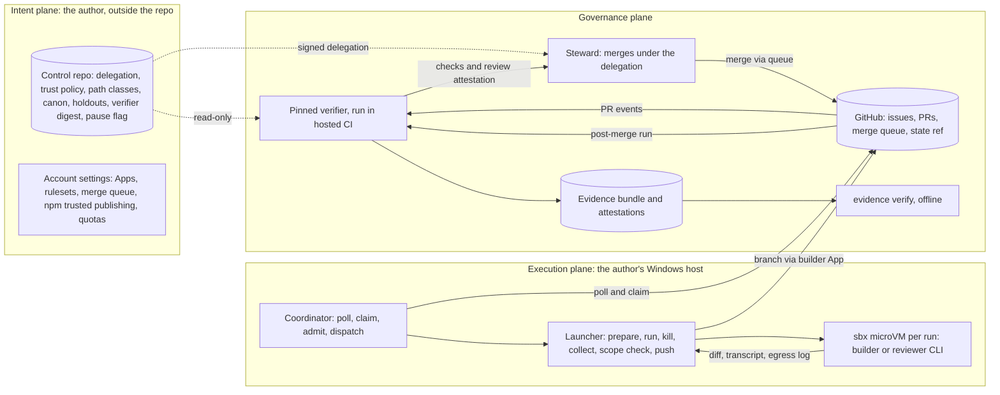

# AgentFlow Governed Factory

- **Author:** Samuel
- **Status:** Draft
- **Date:** 2026-11-24

---

## Overview

AgentFlow is an open-source governance layer for AI coding agents (Apache-2.0, v1.12.0, one maintainer). This design turns it, over about 26 weeks, into a governed factory: agents take work from GitHub issues, build it in contained environments, review each other across model vendors, and merge it with no per-change human approval, while every step leaves evidence that a third party can verify offline. The factory builds itself: the work in this design is carried out by agents through AgentFlow. The author still performs a small set of recurring acts, such as signing the delegation, admitting each milestone and checking in at least weekly; [Human acts](#human-acts) lists them.

The design has three planes:

- **Intent plane (human).** The author sets goals, risk policy, the delegation of merge authority, and the account-level settings that contain the agents. These change rarely and are never reachable by an agent.
- **Execution plane (rented, contained).** Claude and Agy coding CLIs run on the author's own subscription logins, on the author's always-on Windows machine, inside WSL2 substrates that start clean for each run and cannot reach credentials, the network or files they were not given.
- **Governance plane (AgentFlow).** Role passes, review attestations bound to a candidate digest, oracle custody, path ownership, a pinned verifier, a merge steward acting under a signed delegation, signed and timestamped evidence, and a projection that maps that evidence to GxP clauses.

The month-6 claim is narrow: **the named reference stack works end to end and is in actual use**, by the factory building itself and on the author's own repositories. A published conformance report shows two implementations passing each port's suite. The package that supports an implementation-and-services offer contains an npm release, a mock-GxP sample repository, an offline evidence verifier, a case study with measured numbers, a public claims ledger, technical documentation, manuals and the product website.

The source for every decision in this document is `governed-factory/concepts_brief.md` (decisions D1-D38). Facts about today's code were checked during the brainstorm; each is cited with its file.

**How to read the implementation plan.** At the author's choice, this document lists files for every milestone. File lists for week 0 and M0 rest on code read during the brainstorm. Lists for M1 onward depend on what week 0 and M0 find, so each milestone starts by re-verifying its file list against the code and recording any change in this document before work begins.

## The Problem

AgentFlow's concepts are ahead of most frameworks in its space, but its documents claim more than its code does, it cannot run work unattended, and nothing it records can be verified by an outsider. Those three gaps block the two things the author needs within six months: real use, and a credible basis for an implementation-and-services offer.

**1. Documented controls are not implemented.** The guiding principles name six modules as the enforcement for tamper-evident records, deadlock-free gates, process supervision, fencing, handover limits and read-only review. None of them has an importer in the product outside tests (`lib/audit/role-flow-span.mjs`, `lib/gates/gate-sweeper.mjs`, `lib/qa/process-supervisor.mjs`, `lib/qa/qa-contract-verifier.mjs`, `lib/runtime/handover-protocol.mjs`, `lib/runtime/lease-fencing.mjs`). They passed CI because the reachability audit (`scripts/audit-reachability.mjs`) scans only `lib/core/` and `lib/verification/`. The public product page repeats one of these claims: it says test and review authority is read-only, while `AGENTS.md` says read-only is guidance and only oracle edits are denied. A regulated buyer's first audit would find this.

**2. Agents are not contained, so they cannot run unattended.** Spawned agent CLIs inherit the user's home directory, so the user's own harness hooks, rules and MCP servers load into every run (`lib/providers/local-cli.mjs` passes `HOME` and `USERPROFILE`). A `gh auth token` fallback is reachable (`lib/sources/github-credential.mjs`). The launcher is a one-shot `spawnSync` call with a 120-second timeout and no cancel. There is no kill switch, no per-day limit, no network control, and nothing launches agent work without a person. Production agent platforms and the published incidents of 2025-2026 (a deleted production database, a wiper prompt shipped in an IDE extension, secrets stolen through agent CLIs, a private repository leaked through a malicious issue) point to the same missing controls: a fresh sandbox per run, egress control, no credentials in the agent, and a kill switch.

**3. Gates and evidence rest on self-assertion.** A gate accepts self-asserted JSON, and "human" is a registry slug (`lib/core/gate.mjs`). Evidence records are digested and chained (`lib/core/run-state.mjs`), but unsigned, with timestamps the writer chooses. The cross-vendor review check exists but never runs, because nothing sets the builder receipt it reads (`lib/core/execution-receipt.mjs`). Under agent merge, anything that can write the state ref or a GitHub comment could forge an approval.

**4. There is no regulated-industry story, and no proof of use.** The repository has no GxP content: receipts lack signer identity, the meaning of a signature and the reason for a change. The package is not on npm, the only consumer is a preview that was never applied, and the newcomer reads about 1,150 lines of policy before doing anything.

**Why this matters now.** The surveyed frameworks split into popular prompt packs with no enforcement and engines that enforce but sign nothing; none targets regulated software delivery. That gap is the opening AgentFlow can occupy, but only with controls that exist in code and evidence an outsider can check. A services offer is sold on a working demonstration and a case study, not on a feature list, so the product has to be demonstrably in use by month 6.

**Proposed solution in one paragraph.** Make every documented claim true or retract it, under a CI rule that keeps it that way. Contain the agents with controls that live outside the repository, so the agents can merge anything inside it without being able to change the box around them. Judge each change with a verifier pinned from the last release, a cross-vendor review and holdout tests the builder cannot read. Let a steward agent merge under a delegation the author signs, through a merge queue that reverts failures automatically. Sign and timestamp the evidence so a third party can verify it offline, and generate a GxP trace from that evidence. Build all of it through AgentFlow itself, and publish the measured result.

## Goals

Each goal is met when its check passes; every check can be rerun by someone other than the author.

- **G1. Every claim is backed or retracted.** Every `MUST` and `INVARIANT` line in `docs/guiding-principles.md`, `AGENTS.md`, the README and the public product pages has a claims-ledger row marked `implemented`, `measured`, `planned` or `retracted`. CI fails on a new such line without a row, and on any document that says "supports X" without an `implemented` row linked to a passing conformance run. The reachability audit covers `lib/audit`, `lib/gates`, `lib/qa` and `lib/runtime`, and reports zero unexempted unwired modules.
- **G2. Agents cannot escape their box.** A committed red-team suite shows that an agent run cannot read `~/.ssh` or the `gh` configuration, use an ambient token, push to a protected branch, reach a host outside the allowlist, write outside its worktree, or exceed its time or run budget. The kill switch halts a run in under 10 seconds. Two substrate implementations pass the suite, and a deliberately weak adapter fails it.
- **G3. The factory runs dark and merges its own work.** A 48-72 active-hour soak of about 20 issues completes with zero containment escapes. The steward agent merges under a signed delegation through a merge queue; a drill shows a bad change merged, caught after merge, and reverted without human action; the circuit breaker trips on a seeded failure run. The autonomy ladder reaches L3 (`factory-core` changes behind the time-lock, then a `next` prerelease cut by the steward).
- **G4. Each change is judged independently.** Every merge carries a review attestation from the other model family, bound to the candidate digest, and the required check fails if it is stale or missing. A negative test proves the builder's token cannot read the holdout tests. A seeded vacuous test and a seeded defect are both caught.
- **G5. Anyone can verify the evidence offline.** A third party runs `evidence verify` on a clean machine, on Windows and on WSL, without the author's keys, and gets a pass. Tamper tests are detected: a flipped byte, a deleted record, reordered records and a back-dated timestamp. The result does not change with every integration package and the network removed.
- **G6. Evidence maps to GxP clauses.** For the mock-GxP repository, a generator produces a trace from requirement to issue, PR, tests and approval using recorded evidence only, with 100% of requirements linked. The mapping marks each clause covered, partial or out of scope with a reason, shows the missing individual human e-signature on agent merges as partial, and uses only "supports" and "maps to".
- **G7. The factory can be paused and resumed at any time.** Pausing drains in-flight work and stops merges; resuming reconciles from durable state and produces the same evidence chain with no duplicates, proven by a conformance case. The factory pauses itself after 7 days without a human check-in (configurable).
- **G8. The package is published and the stack is in use.** `agentflow-sdlc` is on npm under `latest` with provenance, and a quickstart reaches a first governed PR in under 10 minutes on Windows and WSL. The case study reports measured numbers (PRs, audit effort, rejected PRs, rework, reverts, escapes, circuit-breaker trips, spend, containment events, host downtime) and labels each claim as about the factory itself (case B) or about software it builds (case A). The conformance report, supplier table, responsibilities table, manuals and product website are published. A third party runs the demo from a clean machine. The factory and the author's own repositories run on the named stack.

## Non-Goals

- **No narrowing of the product's multi-agent support.** Codex, Grok and Pi stay supported. D3 (Claude and Agy, no Codex) describes what builds this repository, not what the product supports.
- **No compliance or validation claim.** The design supports GxP work and maps evidence to clauses. It does not claim that AgentFlow, the factory or anything it builds is compliant, validated or certified, and there is no external validation.
- **No framework integrations in the 26 weeks.** Google ADK, Celesto and external optimizers (DSPy, GEPA, ACE) are not integrated. Runtime self-modifying agents are never integrated.
- **No hosted execution for agent runs.** Agent runs stay on the author's machine. Hosted runners are used only for jobs that carry no agent login (deterministic checks, the verifier, npm publishing).
- **No enterprise features.** No SSO, SIEM export beyond the existing optional OpenTelemetry path, policy engines (OPA, Cedar), or source systems other than GitHub.
- **No unattended runs on Windows native or macOS.** Those platforms are supported for interactive use and install tests only.
- **No full verification suite beyond the stated checks.** Mutation testing, judge calibration and a large replay benchmark are deferred.
- **No quality-system tooling.** No CAPA lifecycle, periodic-review tooling, training records, or supplier qualification beyond one template.
- **No business work.** Prospects, practitioner conversations and offer collateral belong to the author and are outside the factory's scope.
- **No capacity planning for the author's time.** The author's hours are not a scheduler input; pause and resume replace it.

## Open Questions

- **Host downtime tolerance**: how long may the author's machine be down per week before a soak counts as interrupted? Proposed: 4 hours planned, everything else logged and excluded from active hours.
- **Website maintenance after this round**: once the factory runs, does it open PRs in the movetheneedle repository with a second single-repository token, or publish a versioned documentation artifact that the site pulls? Deferred until the factory runs.
- **Who performs the week-0 account-level acts**: the author, or the assistant with explicit authorization for a named step and credential.
- **Vendor terms for unattended subscription use**: assumed permitted and unverified; checked in week 0 (W0-18) and re-checked before the M2 exit (M2-9), because the dark-running plan depends on it. A vendor whose terms forbid it becomes attended-only. Evidence gathered 2026-11-24 (search results and vendor pages, not legal advice): Anthropic's legal page says plan limits assume ordinary individual use and bars routing requests through subscription credentials; no explicit ban on unattended use of the unmodified binary was found, but the Consumer Terms text was not read, and secondary reports cite a ban on automated access. Google's Antigravity terms (section 6) call using third-party tools to access the service a breach, and Google staff say unattended background automation on consumer plans is unsupported and can cause lockouts (staff opinion, not terms text). Agy's own headless OAuth is a known gap (google-antigravity/antigravity-cli issue 223). Agy is the likelier vendor to fall into the attended-only fallback.
- **GitHub plan tier for the repositories the factory governs**: GitHub artifact attestations on private or internal repositories need a GitHub Enterprise Cloud plan (GitHub docs, checked 2026-11-23); on other plans they work for public repositories only. Which repositories will the factory govern, and are they public or is the account on Enterprise Cloud? AgentFlow's own repository is public, so the reference stack is not blocked.
- **Where the pinned verifier runs**: it must run from a workflow that a PR cannot edit, and it needs the control-repository read credential. A `pull_request_target` workflow (it runs the base branch's copy) or an organization-level required workflow would do this. Which one the author's GitHub plan allows is unchecked.
- **Where the working copy lives for the sandbox**: WSL ext4 or Windows NTFS, and how it is mapped into the microVM. Settled by the week-0 spike.
- **Home of the pause flag and check-ins**: assumed to be the control repository, writable only by the author. Confirm.
- **Alert channel for the watchdog**: when the host, `sbx` or the coordinator goes quiet, where does the alert go (email, a phone notification, a GitHub issue)? The author picks the channel in week 0, because the watchdog only writes `.agentflow/alerts.json` and exits non-zero.

## Critical User Journeys (CUJs)

### CUJ 1: A scoped issue becomes a merged change with no human action

- **Given**: the factory runs at autonomy level L2 for a governed repository; a signed delegation is in force; an issue is labelled ready and declares its scope (paths, requirement IDs, acceptance checks); the builder's lane has fewer than 3 PRs in flight.
- **When**: the coordinator's next poll finds and claims the issue; the launcher runs the builder (Claude or Agy) in a fresh sandbox and checks the result against the declared scope before opening a PR; a reviewer from the other model family attests to the candidate digest; the pinned verifier's checks pass.
- **Then**: the steward merges through the merge queue under the delegation; post-merge verification passes; an attested evidence bundle exists for the change; metrics are recorded. The author took no action.

### CUJ 2: A bad change is caught after merge and reverted

- **Given**: a change has merged after passing every pre-merge check.
- **When**: post-merge verification (the full suite plus the red-team canon from the control repository) fails.
- **Then**: a revert PR is opened and merged under the delegation without human action; the evidence records both events; the revert counter rises. After N reverts in the window, merging pauses and the kill switch engages. A failure caused by an outage or quota exhaustion is classified as infrastructure and does not count as a revert.

### CUJ 3: A contained agent tries to leave its box

- **Given**: a builder run in a sandbox with no repository credentials and an egress allowlist.
- **When**: the agent tries to read `~/.ssh` or the `gh` configuration, use an ambient token, push to a protected branch, reach a host outside the allowlist, write outside its working copy, edit the verifier, or run past its time or run budget.
- **Then**: each attempt fails and appears in the sandbox's egress and audit log; the run's receipt carries the denial; the red-team suite shows that none of these attempts succeeds.

### CUJ 4: The author pauses and resumes the factory

- **Given**: three items are in flight.
- **When**: the author sets the pause flag in the control repository, or the dead-man pause trips after 7 days with no check-in.
- **Then**: the coordinator stops admitting work and lets in-flight items finish or checkpoint; nothing merges; a pending time-lock stays pending and can still be vetoed. When the flag is cleared, the coordinator reconciles from durable state and produces the same evidence chain with no duplicate claims, PRs or merges.

### CUJ 5: A third party verifies the evidence offline

- **Given**: a published evidence bundle for a release, the trusted root fetched from Sigstore out of band, the author's public key, and a clean Windows or WSL machine with no network.
- **When**: the third party runs `evidence verify`.
- **Then**: it passes. A flipped byte, a deleted record, reordered records, a stale review or a back-dated timestamp each make it fail, with the reason named.

### CUJ 6: The mock-GxP repository produces a clause-level trace

- **Given**: the calibration-logbook repository was built by the factory from its first commit.
- **When**: the trace generator runs over the recorded evidence and the versioned mapping data.
- **Then**: every requirement links to its issue, PR, tests and approval; each Part 11, Annex 11 and GAMP clause is marked covered, partial or out of scope with a reason; the missing individual human e-signature on agent merges is shown as partial; the text says "supports" and "maps to".

### CUJ 7: A change to the factory's own controls waits out the time-lock

- **Given**: an agent PR touches `factory-core` paths (classified in the control repository).
- **When**: it passes the verifier and the cross-family review.
- **Then**: the steward holds it for the time-lock window (24 hours, to calibrate); the author may veto during the window; with no veto the steward merges it. The previous release's verifier and the red-team canon governed the change throughout.

## Technical Plan (Architecture)

### Summary

The factory is three planes joined by a few contracts. The author sets the box once (intent plane). A launcher runs each agent in a disposable microVM (execution plane). A pinned verifier, a steward agent acting under a signed delegation, and attested evidence decide and record what merges (governance plane). Most pieces exist in AgentFlow already or are rented. What is new is the launcher, the substrate port, the evidence glue and the checks that keep claims true.



Text equivalent: the coordinator polls GitHub, claims an issue and hands it to the launcher. The launcher starts a sandbox, collects the result, checks it against the declared scope and pushes a branch with the builder App. The pinned verifier, which reads the control repository, checks the PR. The steward merges through the merge queue under the signed delegation. A post-merge run verifies the result and produces the evidence bundle, which `evidence verify` can check offline.

### Design principles

1.  The agent holds no repository credential and cannot change the box around it.
2.  What judges a change is never part of the change.
3.  Every merge leaves evidence that an outsider can check offline.
4.  Every claim in a document is backed by code or retracted.
5.  Rent isolation, signing and timestamps. Build only the thin launcher and the evidence glue.
6.  The product is multi-agent. Every runtime in the registry (Claude, Agy, Codex, Grok, Pi) stays supported, and each project brings its own configuration and preferences. Claude and Agy are this build's choice (D3), not a product default.

### Components

| Component                                 | Plane      | What it does                                                                                                                                                                                                                                                                                                                           | Status                                                                                     | Milestone                    |
| ----------------------------------------- | ---------- | -------------------------------------------------------------------------------------------------------------------------------------------------------------------------------------------------------------------------------------------------------------------------------------------------------------------------------------- | ------------------------------------------------------------------------------------------ | ---------------------------- |
| Control repository                        | Intent     | Private GitHub repo holding the signed delegation, the trust policy, the path classes (which paths are `factory-core`), the red-team canon, holdouts, seeded defects, the pinned verifier digest, the pause flag and check-in tags. Own rulesets. No builder or reviewer App access.                                                   | New (author sets up)                                                                       | Week 0                       |
| Account settings                          | Intent     | GitHub Apps (builder, reviewer, steward), rulesets, branch protection, CODEOWNERS, required checks, merge queue, npm trusted publishing, vendor quotas, kill authority.                                                                                                                                                                | Author acts                                                                                | Week 0                       |
| Coordinator                               | Execution  | A stateless scheduled session on the Windows host. Polls, claims, admits work by autonomy level and in-flight cap, dispatches, reports. It is the `steer.lead` seat run with the `agentflow-steerer` skill.                                                                                                                            | Extends `scripts/actuate-readiness.mjs`, `lib/core/source-claim.mjs`                       | M1 (poll), M2b (steward)     |
| Launcher                                  | Execution  | Prepares the working copy at the claimed base commit, starts a sandbox through the substrate port, runs the agent headless under the pinned distribution, enforces timeout and cancel, collects diff, transcript and egress log, checks the declared scope, then pushes the branch with the builder App. Writes the execution receipt. | New                                                                                        | M1                           |
| Substrate port and `sbx` adapter          | Execution  | Contract: provision, launch, observe, cancel, destroy, reconcile, with declared credential, filesystem, network and resource limits. Reference implementation: Docker Sandboxes (`sbx`). A second implementation must pass the same suite before the word "pluggable" is used.                                                         | New port, rented implementation                                                            | M1, second implementation M2 |
| Pinned verifier                           | Governance | A release artifact, identified by digest in the control repository, run as a required check from a workflow the PR cannot edit. It runs the PR manifest, path-ownership, declared-scope, holdout, no-op-test, claims-ledger and review-freshness checks, plus the red-team canon for `factory-core` changes.                           | Packages `scripts/validate-*.mjs`; new checks                                              | M0 to M2                     |
| Reviewer lane                             | Governance | A reviewer run in its own sandbox, read-only, from the other model family, producing a review attestation bound to the candidate digest.                                                                                                                                                                                               | Wires `lib/core/review-attestation.mjs`, `lib/core/execution-receipt.mjs`                  | M2                           |
| Tester lane                               | Governance | A black-box tester run in its own sandbox: only the built artifact is mounted (no source), tools are limited by `roles/tester/tool-policy.json`, and the tools used come from the captured transcript and not from the tester's own report. Its "passed" verdict is checked by the artifact contract.                                  | Wires `lib/qa/qa-contract-verifier.mjs`                                                    | M2                           |
| Steward and merge path                    | Governance | A fresh session per decision. Evaluates readiness with `lib/core/steering-merge-policy.mjs` under a delegation from the control repository, merges through the queue as its own App, holds `factory-core` changes for the time-lock. Can hold or release; cannot override the evaluator.                                               | Upgrades `lib/core/delegation-grant.mjs` (signed issuer), `lib/providers/github-merge.mjs` | M2b                          |
| Post-merge verification and revert        | Governance | Runs the full suite and the canon after each merge, opens and merges a revert on failure, counts reverts, trips the circuit breaker and the kill switch.                                                                                                                                                                               | New                                                                                        | M2b                          |
| Evidence envelope, bundle and attestation | Governance | Records each run's actors, receipts, verifier result and substrate identity in the digest-chained run store, then attests the bundle from hosted CI.                                                                                                                                                                                   | Extends `lib/core/run-state.mjs`, receipts                                                 | M3                           |
| `evidence verify`                         | Governance | Offline checker: chain integrity, attestation against a trusted root, signed human acts against the author's public key, candidate digest, timestamps.                                                                                                                                                                                 | New                                                                                        | M3                           |
| Claims ledger and reachability audit      | Governance | A row for each `MUST` or `INVARIANT` line and each public claim; CI blocks new claims without a row and unwired modules.                                                                                                                                                                                                               | Extends `scripts/audit-reachability.mjs`; new ledger                                       | M0                           |
| GxP projection                            | Governance | Reads recorded evidence and versioned mapping data, emits a trace matrix with covered, partial and out-of-scope clauses.                                                                                                                                                                                                               | New                                                                                        | M4                           |
| Learning pipeline                         | Governance | The v1.9.0 refinement pipeline, wired as a propose-only worker role inside the learning boundary.                                                                                                                                                                                                                                      | Wires `lib/refinement-engine.mjs`                                                          | M4                           |
| Conformance and red-team suites           | All        | One suite per port; the red-team events double as the substrate suite; a deliberately weak adapter must fail it.                                                                                                                                                                                                                       | New                                                                                        | M1 onward                    |

### How a unit of work flows

1.  **Poll.** On each tick the coordinator reads the pause flag, then asks each source adapter for work items. For GitHub this uses `listWorkItems`, which makes one comment fetch per issue (ADR 016), so tick length and API use are tracked.
2.  **Claim.** It claims an item through the append-only claim log, where the earliest trusted writer wins. Today the claim ID is random and the append is read-then-write, so this plan changes both: a deterministic claim ID derived from source, item and event, and an append that is conditional on the log revision. Then a second poll, or a later relay delivering the same event, produces one claim.
3.  **Admit.** It admits the item only if the repository's autonomy level covers the change class (path classes come from the control repository, not the repo), the goal the item belongs to has an agreed admission gate (a waiting, refused or stale gate admits nothing), and the builder's lane has fewer than 3 PRs in flight. A lane is a builder vendor, so the cap is 3 per lane, configurable, and at most 6 PRs are in flight with two lanes.
4.  **Prepare.** The launcher creates the working copy at the claimed base commit and starts a sandbox with an egress allowlist and no repository credentials.
5.  **Run.** The agent works headless under the pinned distribution (for example `claude-agy`), with a timeout and a run budget.
6.  **Collect.** The launcher takes the commits, transcript and egress log out of the sandbox and destroys it.
7.  **Check and push.** The launcher compares the changed paths with the issue's declared scope, and pushes the branch and opens the PR with the builder App. The agent never holds a push credential, which follows the brief's "single-repo token with no push or merge right".
8.  **Verify and review.** The pinned verifier runs in hosted CI. A reviewer run from the other family attests to the candidate digest.
9.  **Merge.** The steward evaluates readiness and merges through the queue, or holds the change for the time-lock.
10. **Record.** Post-merge verification runs, and the evidence bundle is attested.

### Contracts

**Intake seam.** A trigger delivers only a reference (source, item ID, event type). It never delivers content: the source adapter re-reads the item, so a pushed or polled event cannot inject text. The trigger now is the scheduled poll. A webhook relay is a later trigger that delivers the same reference. The source adapter port already has GitHub and filesystem implementations, so a Linear or board adapter is a third implementation and a relay is a second trigger. Both stay outside the 26 weeks (Non-Goals), but the seam accepts them. A conformance case checks that the same event arriving twice produces one claim.

**Substrate contract.** The adapter declares what it guarantees: credentials inside the sandbox (none from GitHub), writable paths (the working copy), network (an allowlist, identified by a digest), resource and time limits, cancel semantics (the whole process tree) and destroy semantics (nothing left behind). The receipt records the actual model, the substrate and its version, the image digest, the egress-policy digest and the kill result. The conformance suite covers reading `~/.ssh`, using an ambient token, pushing to a protected branch, reaching a non-allowlisted host, writing outside the working copy, overrunning time or budget, cancel, restart reconciliation, cleanup, and a candidate that edits its own verifier.

**Signing seam (decision D-A1).** GitHub is the only signer and attestor of machine-produced evidence (artifact attestations from hosted CI). Human acts, which are the delegation, policy changes and check-ins, are signed commits or tags made with the author's key; GitHub verifies them. A PR review is a database record and is not used as a signature. The seam has two operations, sign a statement and verify a bundle against a trust policy. Its trust policy maps each scheme's identity (an SSH fingerprint, a workflow identity, an App ID) to a principal kind (human, builder, reviewer, steward, CI) and lists accepted schemes, trust roots and required meanings. The policy ships with the pinned verifier, so an agent cannot change the scheme. The RFC 3161 timestamp is a separate optional seam. "Pluggable" is not claimed for signing until a second implementation passes the same suite.

**Delegation record.** Fields: ID, issuer key fingerprint, steward App ID, scope (repositories, branches, risk classes, actions), expiry, revocation pointer and policy version. It is a signed commit in the control repository. Revoking it means removing the App installation or setting the pause flag.

**Evidence envelope (C3).** Fields: schema version; subject (commit and artifact digests); requirement IDs; risk class; actors (principal kind, ID, vendor, model family, actual model, effort); role-pass references; review attestation reference; verifier digest; substrate block and evaluator block (present but null until used, so signed history never needs a migration); timestamp source; signature blocks tagged by scheme; an `assurance` field marking unsigned legacy records.

**Trust boundaries.**

| Holder                      | Holds                                                                          | Cannot                                                                                |
| --------------------------- | ------------------------------------------------------------------------------ | ------------------------------------------------------------------------------------- |
| Builder sandbox             | A working copy; its model login (Claude's is brokered by `sbx`, Agy's is open) | Read any GitHub credential, reach hosts off the allowlist, see the control repository |
| Launcher on the host        | The builder App token (branches and PRs only)                                  | Merge, read the control repository                                                    |
| Reviewer sandbox            | A read-only working copy                                                       | Write code, push                                                                      |
| Pinned verifier (hosted CI) | The control-repository read credential, attestation permission                 | Run workflow code a PR supplied                                                       |
| Steward                     | The merge App token, control-repository read                                   | Override the evaluator, write code                                                    |
| Author                      | The signing key, account admin                                                 | Nothing reaches this from the factory                                                 |

### Merge, verification and recovery

Merge needs five things: required checks from the pinned verifier, a cross-family review attestation bound to the candidate digest, the evaluator's approval, a delegation in force, and, for `factory-core` paths, the time-lock. Issue, PR and comment text reaches the steward as data. A prompt that argues for merging something the evaluator held does nothing, because the evaluator's output is the gate.

After the merge, the post-merge run executes the full suite and the red-team canon from the control repository. A canon-ratchet check fails any PR that removes or loosens a case, by comparing against the control repository's copy. A failure produces a revert. N reverts in the window pause merging and engage the kill switch.

The autonomy ladder gates admission by change class: L1 covers docs, tests, ledger entries and the mock-GxP repository; L2 covers code outside `factory-core`; L3 covers `factory-core` behind the time-lock and then a `next` prerelease, which the steward cuts. The `latest` release and the verifier digest pin stay human acts (see [Human acts](#human-acts)). Promotion needs a soak with no containment escapes and no post-merge failure, counted in active hours.

### Policy changes this design requires

This design contradicts rules that bind this repository today. They are recorded here so that each change is explicit and has an owner. W0-20 lists every sentence that changes.

**High-assurance review (decided by the author, 2026-11-24).** `AGENTS.md:69`, `docs/agent-workflow.md:587-590`, `docs/guiding-principles.md:43` and `:59`, and the default policy in `docs/steering-merge-authority.md` require a human to review and approve high-assurance work before merge. The product keeps that rule by default. The design adds an opt-in setting, off by default, that lets a signed delegation count as the human decision for the change classes the delegation names. The setting lives only in the project's control repository (see "Configuration authority" below), so a project without a control repository cannot turn it on. This repository turns it on for all classes, including high-assurance, so the steward merges `factory-core` changes and releases without a per-change human act. Everything else stays: the cross-family review, the pinned verifier, the time-lock and the post-merge revert. For the GxP mapping, an agent merge carries no individual human e-signature, and the mapping shows that as partial. `defaults/AGENTS.md` and the default configuration do not change, so a project that adopts AgentFlow keeps the human requirement unless it opts in.

**Publication decision (decided by the author, 2026-11-24).** `docs/steering-merge-authority.md` says publication needs a separate authenticated decision, bound to the exact repository, PR number, head commit, merge strategy and deletion policy, consumed once, and that a changed head needs a new decision. The standing delegation does not replace that. For each merge the steward issues a decision with exactly that binding (the subject is `recordDigest({repository, prNumber, headOid})` and the action is `recordDigest({action: 'merge', repository, prNumber, headOid, strategy: 'squash', deleteBranch: true})`), recorded as "on behalf" with the delegation ID. The endpoint verifier authenticates the steward's App identity and the signed delegation (scope, expiry, revocation) instead of a person at the merge. Operation admission consumes each decision once, so replay cannot publish twice, and the merge passes `gh pr merge --match-head-commit <headOid>`. Within its scope the steward issues its own per-merge decisions, so the delegation's scope is the control: it names repositories, branches, change classes and an expiry, and stays narrow.

**Scope of the policy edits (decided by the author, 2026-11-24).** Every sentence that requires human review or approval for high-assurance work is edited, in three groups: the binding policy and the steerer's own rules, this repository's agent instructions, and the docs that describe the default rule. Each is qualified with "by default" and points to the opt-in section in `docs/steering-merge-authority.md`. The author makes the edits by hand in one human-authored PR before any unattended run (W0-20), because agents must not edit their own governing documents. After that, the binding files are `factory-core` paths under the time-lock. A statement that tells an agent not to waive a gate (the auditor skill) stays as written, because the delegation and not the agent satisfies the requirement.

**Configuration authority (decided by the author, 2026-11-24).** `docs/modular-architecture.md:55-67` gives each canonical setting one owner, enforced by `validate:authority`, and `docs/guiding-principles.md:123` forbids parallel configuration mechanisms. The control repository is the only owner of trust-bearing policy: the path classes (including which paths are `factory-core`), the delegation and its opt-in, the trust policy, the canon, the holdouts and seeded defects, the verifier digest, the pause flag and the check-ins. The repository's own configuration holds only a reference to the control repository and its expected ref, in `agent-workflow.config.json` as a source binding. `validate:authority` fails when a trust-bearing key appears in `sdlc.config.json` or `agent-workflow.config.json`, and holds, rather than passes, when the control repository cannot be read. `manifests/path-ownership.json` keeps its own job, which role may write which path, which is separate from a path's risk class. Agents cannot reach the classifier or the opt-in, and an unreachable control repository stops merges rather than weakening them.

### Human acts

The factory needs no human approval for an individual change. These acts stay with the author. Each is a signed commit or tag in the control repository, a gate answer in the author's own terminal, or an account-level setting, so an agent cannot perform it. The GxP projection cites this table for "who did what".

| Act                                                                                                                                                                                                                    | How often                                                             | Why it stays human                                                      | Built in                 |
| ---------------------------------------------------------------------------------------------------------------------------------------------------------------------------------------------------------------------- | --------------------------------------------------------------------- | ----------------------------------------------------------------------- | ------------------------ |
| Account and host setup: `sbx`, the control repository, the three GitHub Apps, rulesets, branch protection, CODEOWNERS, required checks, the merge queue, npm trusted publishing, kill authority, quotas and host rules | Once, then on each change                                             | These settings contain the agents, so no agent can reach them           | W0-12                    |
| Edit the governing policy                                                                                                                                                                                              | Once before the first unattended run, then on each policy change      | Agents must not edit their own governing documents                      | W0-20                    |
| Sign, renew or revoke the delegation                                                                                                                                                                                   | At the start, at each expiry, and on an incident                      | It is the advance human decision that lets the steward merge            | W0-12 (first one), M2b-1 |
| Admit a milestone goal                                                                                                                                                                                                 | Once per milestone, nine in total                                     | The person agrees the intent and exit criteria before work starts       | W0-19                    |
| Check in                                                                                                                                                                                                               | At least every 7 days; otherwise the dead-man rule pauses the factory | Shows that an accountable person is still present                       | M1-8                     |
| Pause, resume or kill                                                                                                                                                                                                  | When needed                                                           | The pause flag is writable only by the author                           | M1-8                     |
| Pin the verifier digest                                                                                                                                                                                                | Each verifier release                                                 | Release N-1 judges release N, so an agent must not choose its own judge | M2-2                     |
| Apply a revised execution distribution                                                                                                                                                                                 | When measurements support a change                                    | It is an authorized policy migration                                    | M2-4                     |
| Publish the npm `latest` release                                                                                                                                                                                       | Once, at M5                                                           | The first public release is the author's decision                       | M5-4                     |

**Releases (decided by the author, 2026-11-24).** The steward cuts `next` prereleases: after a time-locked `factory-core` merge it pushes a `vX.Y.Z-next.N` tag through the steward App, and `publish.yml` publishes it with provenance under the `next` dist-tag. The `latest` release and the verifier digest pin stay human, because an agent mistake there is the hardest to undo: `latest` is what every adopter installs by default, and the verifier is the factory's own judge. A tag ruleset enforces the split: the steward App may create only `v*-next.*` tags, and only the author may create a release tag without the `-next.` suffix.

A claims-ledger row marks this table `implemented` only when each act's work item is done. A new human act, or an act that moves to the steward, changes this table in the same PR.

### Coordinator states, pause and resume

The coordinator is running, draining, paused or killed. Pause is graceful and resume is one command. The pause flag and the check-in tags live in the control repository. With no check-in for 7 days, the coordinator pauses itself. Resume re-reads issues, claims, receipts and the run store, and it is idempotent by construction: claims carry a deterministic ID and a conditional append, the run store uses compare-and-swap on its state ref, receipts are content-addressed, and the conformance suite includes a pause-mid-run-and-resume case. The gate sweeper resolves a hung automated gate to a recorded `timed_out`, with a configurable deadline for person gates and persisted state. The process supervisor manages the launcher and `sbx` processes on the Windows host, which is where its `taskkill` approach applies. Until the week-0 gate passes, no agent run starts outside the guarded runner; the gate is re-run at the M1 and M2 exits.

### Learning boundary

The wired v1.9.0 pipeline is a worker role. Its output is an ordinary PR through the same pinned verifier, cross-family review and, for control files, the time-lock. Evaluators, verifier source, reviewer and judge prompts, thresholds and holdouts are outside its write scope. Its reward comes from lagged post-merge outcomes, and its input (`.agent-runs/*.jsonl`) is agent-writable, so lessons are sanitized and never applied automatically. It has its own identity and an idle-only quota lane. External optimizers wait until L3 and enough scored outcomes exist.

### What is reused, new and retired

- **Reused:** `lib/core/run-state.mjs` (chained events), `review-attestation.mjs`, `oracle-custody.mjs`, `execution-receipt.mjs` (four-eyes check, once wired), `lib/qa/qa-contract-verifier.mjs` (artifact check, through the tester lane), `delegation-grant.mjs`, `steering-merge-policy.mjs`, `gate.mjs`, `lib/providers/github-merge.mjs`, `lib/config/quota-policy.mjs`, the source adapter port, the execution distributions and the `agentflow-steerer` skill.
- **New:** the launcher, the substrate port and `sbx` adapter, pinned-verifier packaging, the control-repository reader, `evidence verify`, the claims ledger, the GxP generator, the signed delegation issuer, the conformance and red-team suites, the intake poller.
- **Retired:** the `role-flow-span` chain (re-pointed to `run-state.mjs`), `lease-fencing`, the 15% handover cap, WIP checkpoint branches, and the OpenRig adapter and bridge beyond the minimal scenario (W0-13, M0-9).

### Known risks the design carries

- **Single root of trust.** The author's GitHub account and signing key are the root. Hardware-backed keys and two-factor authentication are week-0 acts.
- **Closed-source substrate.** `sbx` is pre-1.0 and had about six CVEs in 2026. It is pinned, monitored, listed in the supplier table, and replaceable through the port.
- **Vendor terms.** Agy may be attended-only (Open Questions).
- **Outages counted as failures.** Failure causes are classified so an outage cannot trip the revert circuit breaker.
- **Tester lane scope.** M2 gains a tester lane and a built-artifact packaging step. If M2 slips, the tester claim stays `planned` in the ledger instead of shipping half-built.
- **Week 0 is heavier.** It carries a minimal kill switch, run cap and guarded runner (built attended) and four spikes (`sbx`, baseline, digest and signing, vendor terms). If it overruns, nothing runs unattended and the M0 documentation and ledger work continues attended.
- **Surface growth.** The plan adds about 14 CLI verbs and 6 schemas and retires about 8 verbs. No number is enforced, so the first sign of drift is a PR body with no stated reason.
- **Two lanes double the exposure.** Up to 6 PRs can be in flight, so more changes await review and merge at once. Quota and the merge queue are the limits.
- **A `next` prerelease used in production.** The steward cuts `next` without a person. The release docs say it is a prerelease channel, and `latest` stays a human act.
- **Broad delegation scope.** Within its scope the steward issues its own per-merge decisions. The scope in the signed delegation, the time-lock and the pinned verifier are the limits, so the scope stays narrow (repositories, branches, change classes and an expiry).
- **Admission gates stall the factory until answered.** There are about nine admissions over the 26 weeks (the program goal and eight milestones). The factory fails closed, and the coordinator's morning digest lists waiting gates.
- **The coordinator is a model session.** A hostile issue cannot change what merges, because the evaluator and verifier decide, but it can waste runs. The in-flight cap and quotas bound that.

### Deviations from the brief (to reconcile at Step 6, then update the brief)

1.  Host rule: unattended runs use `sbx` microVMs on the Windows host, replacing "WSL2/Linux only" (author-approved).
2.  The week-0 containment floor uses an `sbx` sandbox and not a throwaway WSL2 distro. The spike replaces the distro check.
3.  The rent table's isolation row changes from a WSL2 distro or local container to `sbx`.
4.  The non-goal "no unattended runs on Windows native" is reworded: agents run in Linux microVMs, and the launcher and steward run on the Windows host.
5.  The second substrate is the assembled WSL2 stack (the fallback), which also makes the conformance claim testable.
6.  D17 changes target: the process supervisor manages Windows-host processes, not WSL2 trees.
7.  OpenRig becomes an optional adapter (author decision, 2026-11-24). It is trimmed to the minimal scenario after a capability review against OpenRig 0.7.19 (W0-13, M0-9), and the steward's identity check moves to its GitHub App identity (M2b-2).
8.  Week-0 acts gain: install and pin `sbx`, create the Docker account, create the control repository.
9.  The supplier table gains rows for Docker (`sbx`) and GitHub (attestations, Apps, merge queue).
10. Resolved by the author (2026-11-24): substrate implementations live in `adapters/<name>/`, as the brief says. The port contract stays in `lib/core/substrate-port.mjs` and the launcher stays in `lib/substrate/`. Updated by the author (2026-11-24): a substrate is a provider with a new `containment` facet in `lib/core/provider-binding.mjs`, because `docs/modular-architecture.md:33` puts execution targets in the provider layer. `lib/providers/registry.mjs` registers the containment providers, so there is no separate substrate registry and no new adapter kind. The launcher accepts a containment provider only with a recorded passing conformance run for that provider and version, never on its descriptor.
11. The M0 item "fix the top-level resume's `mockPacket` claim" is dropped: commit `c4df9de` already removed it. Only a stale paragraph in `docs/maintainers/process-autonomy-reconciliation.md` remains.
12. Resolved by the author (2026-11-24): the word "fencing" is retracted from prose and the live mechanisms are renamed: "writer generation" for the run store (generation plus compare-and-swap) and "epoch counter" for the `fencingToken` field in resolution ledgers and review-round receipts. The field name `fencingToken` stays as a legacy identifier, because it is part of digest-sealed records and renaming it would change their digests; a dual-read alias is deferred past the 26 weeks. Historical ADRs and release notes get an erratum pointer and are not rewritten (M0-10).
13. Resolved by the author (2026-11-24): as the brief says, the Gemini route fix lands in M0 together with project-supplied profile loading and this repository's `claude-agy` profile, and the author authorizes the pin then (M0-11). M2-4 is only a possible revision after measurements.
14. Resolved by the author (2026-11-24): `lib/qa/qa-contract-verifier.mjs` is kept and wired through a new tester lane in M2 (M2-10). The module only checks a tool list that the tester reports itself, so the lane takes the tools actually used from the launcher's captured transcript, and enforces black-box testing by mounting only the built artifact. The brief was silent on this module.
15. Surface freeze (author decision, 2026-11-24): the brief's rule "retire one or state why" is applied as "state why". The plan adds about 14 CLI verbs, 6 schemas and 1 validator and retires about 8 verbs and 1 validator (counted from the plan rows, approximate). No count budget is enforced.
16. In-flight cap (author decision, 2026-11-24): 3 PRs per agent lane, where a lane is a builder vendor, as D5 says. The standing rule's "more than 3" wording is an off-by-one and is corrected in the brief.
17. Phase gates (author decision, 2026-11-24): the brief's "every phase boundary is a person-signed gate" is implemented as milestone goals admitted through the existing `admission` person gate. Person gates bind to subjects and never to a phase number (README, `docs/person-gates.md`), so there is no separate milestone tag.

## Alternatives Considered

The first seven alternatives are program-level. The rest follow the architecture decisions. Where the council or reviewers recommended against an option and the author agreed, the reason given is the technical finding.

### Alternative A: Keep the original six-phase roadmap

- **Pros**: Familiar order (truth, safe execution, verification, evidence, GxP, enterprise), and it matches how the gaps were first found.
- **Cons**: Sized for a team: 24-37 focused weeks for one maintainer. It puts evidence integrity and GxP in the wrong order, so the evidence schema would need migrating after signing starts.
- **Reason for Rejection**: Rejected by author: the milestones in this design start from a containment floor and a walking skeleton, design the evidence envelope first, and keep the package demonstrable every week.

### Alternative B: Build the execution engine in-house

- **Pros**: Full control of scheduling, isolation and result handling, and no dependency on a vendor's roadmap.
- **Cons**: A platform, not a slice: the existing launcher is a one-shot `spawnSync` call with no cancel. It is far beyond what one maintainer can review and keep current.
- **Reason for Rejection**: Rejected by author: rent isolation, and build only a thin launcher. Rented pieces are `sbx`, GitHub and the signing tools.

### Alternative C: Keep a human at the merge, in full or for high-risk classes

- **Pros**: The strongest accountability story for a regulated buyer: an individual human approves each change, which closes the Part 11 signature gap for those changes. The council and reviewers recommended a policy-authorized version of this: agents merge light and standard changes, and a human signs release, high-assurance and `factory-core` changes.
- **Cons**: Human attention becomes the throughput limit, and the factory cannot run dark. The design already treats the author's hours as unscheduled.
- **Reason for Rejection**: Rejected by author: the end state is unconditional agent merge, including `factory-core` and `next` prereleases (the `latest` release and the verifier pin stay human; see Alternatives AW and AX). The Technical Plan adds the controls that make that recoverable (a box outside the repo, a pinned verifier, cross-family review, a merge queue with revert, a time-lock and an external red-team canon), and shows the signature gap as partial in the GxP mapping. A human merge is kept only for the early autonomy levels.

### Alternative D: Wire every unwired module

- **Pros**: It makes every principle in `docs/guiding-principles.md` true as written.
- **Cons**: `lease-fencing` duplicates `seat-lease.mjs`, `role-flow-span` duplicates the stronger chained store in `run-state.mjs`, and the 15% handover cap and WIP checkpoint branches have no measured need. Wiring all of them adds surface area that nothing asks for.
- **Reason for Rejection**: Rejected by author as the default: the cross-machine fencing-token claim (the unwired `lease-fencing` module; the writer-generation fencing in the run store is live and stays), the 15% handover cap, WIP checkpoint branches and the `role-flow-span` chain are retracted in a public claims ledger. The gate sweeper and process supervisor are wired (D17), after adaptation.

### Alternative E: Position AgentFlow as a governed integrator of ADK, Celesto and learning frameworks

- **Pros**: Name recognition, and an answer to "does it work with what we already run?".
- **Cons**: An integrator inherits every dependency's release risk and rarely owns a category. No prospect has asked for any of the three, and the author has used none of them. Each integration is a new supplier in a GxP story that scopes supplier work to one template.
- **Reason for Rejection**: Rejected by author, on the council's and reviewers' findings: the headline is the governance and evidence layer. "Integrator" describes the method, and positioning stays a hypothesis to test. Integrations enter only under the admission rule (deletes a plan item, or is the only way to meet an exit criterion).

### Alternative F: Leave GxP to the end

- **Pros**: It keeps early milestones focused on the controls and the walking skeleton.
- **Cons**: GxP fields (signer identity, the meaning of a signature, the reason for a change) shape the evidence schema, so late GxP work means migrating signed history.
- **Reason for Rejection**: Rejected by author: the envelope is designed first, with a hand-written golden fixture of the final outputs, and the mapping is a projection over recorded evidence.

### Alternative G: Dogfood only on AgentFlow's own repository

- **Pros**: Least setup, and the strongest "builds itself" story.
- **Cons**: It never produces regulated-style artifacts, so the GxP projection would have nothing real to run on.
- **Reason for Rejection**: Rejected by author: a mock-GxP calibration and logbook tracker is a second consumer, built through the factory from its first commit.

### Alternative H: Hosted sandboxes for subscription agents (Celesto hosted, GitHub-hosted runners)

- **Pros**: No local machine to keep powered on, and the hosts provide isolation.
- **Cons**: Agent runs on the author's Claude and Gemini subscription logins would put those logins on a third party's machines. Celesto's own page says "isolation, not complete security", its pre-run hooks run client-side, and no Claude Code or Agy support was found.
- **Reason for Rejection**: Rejected by author (D2): subscription logins stay on the author's machine. Hosted runners remain fine for jobs that carry no agent login (the verifier, attestations, npm publishing).

### Alternative I: Google ADK as the agent runtime or evaluation authority

- **Pros**: Apache-2.0, a graph workflow engine, plugin hooks, an evaluation framework with deterministic criteria, and A2A and MCP interoperability.
- **Cons**: It calls models through APIs, which conflicts with subscription-only billing, and some LLM-judged evaluations need billed Vertex services. The workers are Claude and Agy CLIs that run their own tool loops, so ADK would see only a wrapper. Its graph would be a third phase-graph definition. It releases every one to two weeks with breaking 2.x changes.
- **Reason for Rejection**: Rejected by author, on the council's and reviewers' findings: not in this plan. An out-of-process adapter becomes possible only if a customer asks or the subscription-only decision is reopened.

### Alternative J: Runtime self-improving agents, or external optimizers now

- **Pros**: Possible gains in prompts and playbooks. GEPA has a peer-reviewed paper, and DSPy has broad use.
- **Cons**: DGM, SEAL and ADAS rewrite code, weights or evaluators, and DGM faked tool use and deleted its own detection markers. Optimizers need outcome data that does not exist yet, and the post that recommended them is vendor marketing with no benchmark numbers.
- **Reason for Rejection**: Rejected by author: runtime self-modification never. The existing v1.9.0 pipeline is wired as a propose-only worker role inside the learning boundary. External optimizers wait for L3 and enough scored outcomes, probably after month 6.

### Alternative K: A custom hash chain, OPA or Cedar policy, and a full in-toto layer

- **Pros**: Full control of the evidence format and fine-grained, declarative policy.
- **Cons**: Too much for one maintainer, and the chained store already exists in `run-state.mjs`.
- **Reason for Rejection**: Rejected by author: use signed commits, GitHub attestations and an RFC 3161 timestamp (kept as a separate optional seam).

### Alternative L: SSH signatures for everything

- **Pros**: Fully offline verification with only a public key, and one mechanism.
- **Cons**: The root of trust is one key, and agent evidence signed on the agent host would sit next to the agents. It needs a key-custody process for rotation and loss.
- **Reason for Rejection**: Rejected by author: GitHub is the only signer and attestor of machine evidence. SSH-signature verification stays as the cheapest second implementation of the signing seam.

### Alternative M: Sigstore for everything

- **Pros**: One system, no long-lived keys, and identity tied to a login.
- **Cons**: Signing needs the internet and external services, the public transparency log would expose metadata about private repositories, and the trust root needs its own update process.
- **Reason for Rejection**: Rejected by author: GitHub attestations already use Sigstore underneath, and add no second system to run.

### Alternative N: Hold the verifier digest, canon and holdouts in a directory on the Windows host

- **Pros**: No GitHub dependency and the strongest separation from agents.
- **Cons**: No history or backup, and hosted CI cannot read it, so required checks would have to run on the author's machine.
- **Reason for Rejection**: Rejected by author: a private control repository gives versioning, auditability and backup, and hosted CI can read it through a read-only credential.

### Alternative O: Public signed releases as the home for these items

- **Pros**: No extra repository, no secret to guard, and anyone can verify.
- **Cons**: Holdouts and seeded defects cannot be public, because the builder could read them and overfit.
- **Reason for Rejection**: Rejected by author: items that must stay secret need a private home. Public releases remain the home for the pinned verifier itself.

### Alternative P: A throwaway WSL2 distro for each run

- **Pros**: Native to the author's machine, nothing to install, a clear teardown.
- **Cons**: I believe all WSL2 distros share one virtual machine and kernel (unverified), so isolation between runs is filesystem-level. Egress control inside the distro can be edited by an agent that gains root, and importing a distro for each run costs time and disk.
- **Reason for Rejection**: Rejected by author: `sbx` gives a kernel per run and an egress proxy with an audit log, with less of AgentFlow's own code.

### Alternative Q: A rootless container for each run, inside one WSL2 distro

- **Pros**: Fast start, mature controls, and a pinned image digest gives clean evidence.
- **Cons**: Runs share the distro's kernel, and the CLIs' own sandboxes (which depend on Linux user namespaces, unverified) may not work inside the container.
- **Reason for Rejection**: Rejected by author: a per-run kernel is the stronger boundary and `sbx` is the adopted product.

### Alternative R: A disposable Hyper-V Linux VM for each run

- **Pros**: A kernel per run, and discarding a run is deleting a disk.
- **Cons**: A larger launcher to build and maintain, slower starts (my estimate, not measured), and many VMs would compete with the author's own work on the same machine.
- **Reason for Rejection**: Rejected by author: `sbx` provides the same per-run kernel as a product, so none of that has to be built.

### Alternative S: Microsandbox (open-source microVM runtime with SDKs)

- **Pros**: Apache-2.0, about 9k stars, native on Windows, and Python, Rust and TypeScript SDKs suit a launcher.
- **Cons**: Pre-1.0 (v0.7.14). One review reports no OAuth support, so a subscription token would sit in the guest. It has no blocked-request log, and secret substitution needs TLS interception.
- **Reason for Rejection**: Rejected by author: weaker for subscription logins and for audit. It stays a candidate if `sbx` fails its spike.

### Alternative T: Other sandbox products

- **Pros**: Several are open source and some are widely used.
- **Cons**: NVIDIA OpenShell is alpha and needs a separate gateway. StrongDM Leash mounts `~/.claude` and its latest release found was from December 2025 (unconfirmed). Daytona went closed source in June 2026. E2B's self-hosted edition needs KVM and about 12 GiB of RAM. The Kubernetes agent-sandbox project needs a cluster. Coder's agent firewall is in a paid tier. Dagger Container Use is an interactive-agent tool with no egress control found.
- **Reason for Rejection**: Rejected by author, on a research report built from search results and a few fetches. The evidence for Container Use was a single snippet, and Dagger itself, the pipeline engine, was not assessed. Dagger is an unevaluated candidate for running the pinned verifier's checks in containers.

### Alternative U: Assemble the substrate from maintained components in WSL2

- **Pros**: Every piece is open source or vendor-maintained, it stays on WSL2 with repositories on ext4, and it avoids a closed-source dependency. The parts are the Claude Code sandbox with managed settings, Agy's `--sandbox`, an outside-boundary Envoy or mitmproxy egress proxy, firewall rules and a GitHub App token minter.
- **Cons**: The most glue to maintain, shared kernel between distros, a CLI sandbox that covers only shell commands and not MCP or file tools, and a hostname-only allowlist that can be fronted.
- **Reason for Rejection**: Not rejected. Kept as the fallback if the week-0 spike fails, and as the second substrate that makes the "pluggable" claim testable.

### Alternative V: A self-hosted GitHub Actions runner with the shipped reference pusher

- **Pros**: Event-driven and GitHub-native, and it reuses the shipped pusher from #587.
- **Cons**: A self-hosted runner can execute untrusted code from a public repository (my background knowledge, unchecked), and AgentFlow's repository is public. It shares the machine with the credentials and the `sbx` host, and the runner's updates are the author's to maintain.
- **Reason for Rejection**: Rejected by author: poll first. A runner may return as a trigger, behind the same intake seam.

### Alternative W: A webhook relay now

- **Pros**: Event-driven, with nothing inbound to the author's machine if the machine connects out. It is also the route for other services such as Linear or a board app.
- **Cons**: It adds a service to operate, and new signature and replay handling to build and test, and it needs a reconcile sweep for dropped events.
- **Reason for Rejection**: Rejected by author for now: relay later, as another trigger behind the same intake seam. It stays a Non-Goal for the 26 weeks.

### Alternative X: Schedule work by the author's review minutes

- **Pros**: It keeps audit load within the author's available time and gives a natural back-pressure signal.
- **Cons**: It makes the factory depend on the author's calendar and needs a model of review effort that does not exist.
- **Reason for Rejection**: Rejected by author (D21): the author's hours are not a scheduler input. Back-pressure comes from the in-flight cap, the revert circuit breaker and subscription quota, and the author can pause and resume the factory.

### Alternative Y: Keep the OpenRig layer as shipped, or trim it conservatively or moderately

- **Pros**: Keeps shipped capabilities for adopters (the product handoff verbs, recovery, mutation, the workflow generator, tiered builder routing) and avoids retracting merged ADR 016 decisions. The conservative trim removes only dead code. The moderate trim keeps the intake bridge, the workflow generator, the reference pusher, the seat presets and the steer guard.
- **Cons**: The adapter is 18,438 lines (8,471 code, 6,194 tests, 3,773 data) for a layer that is optional and outside the reference stack. About 3,100 lines have no caller outside tests, policy is duplicated in five places, four handoff systems coexist, and nothing has run against a live daemon.
- **Reason for Rejection**: Rejected by author: trim to the minimal adapter (push work into a rig and read evidence back) after a capability review against OpenRig 0.7.19, which now provides several of these capabilities natively.

### Alternative Z: Keep substrate implementations in the core package under `lib/substrate/`

- **Pros**: Follows the repository's port convention (`lib/sources/`, `lib/providers/`), needs no change to the adapter machinery, and has the fewest files.
- **Cons**: Adapter code sits inside the core package, so the brief's separation (nothing in the verifier or `evidence verify` imports an adapter) would rest on a convention and not on a directory boundary.
- **Reason for Rejection**: Rejected by author: implementations live in `adapters/<name>/`, which keeps the separation visible. An architecture-fitness test enforces that the verifier, evidence, signing and verification code never import `adapters/**`.

### Alternative AA: One npm package for each substrate adapter

- **Pros**: The strongest isolation and independent versioning, which suits `sbx` being pre-1.0 and changing often.
- **Cons**: A second package to publish, version and keep compatible with the core contract. This repository is a single package today.
- **Reason for Rejection**: Rejected by author: release overhead and version-skew risk for a one-maintainer project. Revisit if an adapter needs a heavy dependency that the core package should not carry.

### Alternative AB: Retract only the unwired `lease-fencing` module and keep the word "fencing"

- **Pros**: Each ledger claim matches the code exactly, and docs that describe the live mechanisms stay unchanged.
- **Cons**: Readers meet two "fencing" ideas, one retracted and one live, and a retraction can be read as "the run store is unprotected".
- **Reason for Rejection**: Rejected by author: remove the word from prose and rename the live mechanisms ("writer generation" and "epoch counter"), so that nothing live shares a name with a retracted claim.

### Alternative AC: Reverse the retraction and wire cross-machine fencing tokens

- **Pros**: Keeps the original principle 5 promise that two machines cannot work on the same task.
- **Cons**: `lease-fencing` duplicates `seat-lease.mjs`, and the factory runs on one machine (D18), so the wiring would add code with no real caller.
- **Reason for Rejection**: Rejected by author: the claim is retracted, and cross-machine operation is not a goal of the 26 weeks.

### Alternative AD: Do the distribution work in M2, when the factory first needs it

- **Pros**: The loader change is built against a real use, one authorization covers it, and the model and effort choices are made after M1 measurements.
- **Cons**: The Gemini routing bug (Gemini routed through the removed `pi`) stays through M0 and M1, and project-supplied profiles arrive later.
- **Reason for Rejection**: Rejected by author: M0, as the brief says. The bug is fixed early, and a later revision is another authorized migration if measurements require it.

### Alternative AE: Retract `qa-contract-verifier` entirely

- **Pros**: The smallest change, and no unwired module is left behind.
- **Cons**: It loses the one real check in the module (a "passed" verdict needs digested artifacts), which the GxP trace matrix will need.
- **Reason for Rejection**: Rejected by author: the module is kept and wired through a tester lane.

### Alternative AF: Keep only the artifact check and drop the tool check

- **Pros**: Keeps the real check for about 60 lines, with no new lane.
- **Cons**: Leaves the black-box principle (no source reading, no edits) unenforced, so it would stay unclaimed.
- **Reason for Rejection**: Rejected by author: deliver the principle as written, with a tester lane that mounts only the built artifact.

### Alternative AG: A manual week-0 gate, replaced by code later

- **Pros**: Keeps the brief's rule at low cost: a documented manual kill and the `sbx` spike results, with the code kill switch and daily cap arriving in M1 and M2.
- **Cons**: Weeks 1-8 would depend on manual procedures that someone has to keep honest.
- **Reason for Rejection**: Rejected by author: build a minimal code kill switch, run-count cap and guarded runner in week 0, so the gate is enforced by code from the start.

### Alternative AH: No separate week-0 gate

- **Pros**: The simplest plan: controls arrive with each milestone, and unattended runs start with the M2 soak.
- **Cons**: It assumes the author watches the agents during weeks 0-8, and agents would run without containment while they build the containment.
- **Reason for Rejection**: Rejected by author: the brief's gate stays ("no unattended runs before this passes").

### Alternative AI: Only the `sbx` spike in week 0

- **Pros**: The shortest week 0, which matters now that week 0 carries the gate.
- **Cons**: The signed-act slice in M1-13 could hit the line-ending problem before M3-5, and the case study would have no recorded "before" numbers.
- **Reason for Rejection**: Rejected by author: all three spikes run in week 0, as the brief says.

### Alternative AJ: Run each spike where it is first needed

- **Pros**: Week 0 stays focused on the gate and the `sbx` spike, and each unknown is answered just before the work that depends on it.
- **Cons**: The vendor-terms risk would stay open into M2, and a late "no" would arrive after work built on the assumption that it is allowed.
- **Reason for Rejection**: Rejected by author: answer the early unknowns before M0 starts.

### Alternative AK: Net-zero surface, enforced by CI

- **Pros**: It shrinks the surface a newcomer faces and makes the freeze rule real: a `manifests/surface-count.json` fails CI when a count rises without a retirement.
- **Cons**: It adds an M0 audit to find verbs and schemas that are safe to retire, and some planned additions would have to fold into existing command groups.
- **Reason for Rejection**: Rejected by author: accept the "state why" rule as drafted.

### Alternative AL: A capped growth budget

- **Pros**: Growth is bounded and visible, and no retirement audit is needed.
- **Cons**: The cap is a guess. Legitimate work can exceed it, and a loose cap never binds.
- **Reason for Rejection**: Rejected by author: accept the "state why" rule as drafted.

### Alternative AM: At most 3 PRs in flight in total

- **Pros**: The simplest rule, the least exposure if a bad change merges, and at most three changes waiting for cross-family review.
- **Cons**: Three slow items from one lane would block the other lane's work.
- **Reason for Rejection**: Rejected by author: the cap is 3 per agent lane, as D5 says.

### Alternative AN: A signed tag for each milestone boundary

- **Pros**: The simplest mental model: one signed tag in the control repository after the exit criteria pass, and the coordinator admits no next-milestone work without it.
- **Cons**: It is a new mechanism beside the existing person gates, it ties a gate to a phase number (the README says gates bind to subjects), and nothing binds the signature to what the exit criteria showed.
- **Reason for Rejection**: Rejected by author: milestones are goals, admitted through the existing admission gate.

### Alternative AO: No milestone gate beyond delegation changes

- **Pros**: The fewest interruptions and the closest fit to a dark factory: the only signed acts are the delegation, its scope changes (ladder promotions and release) and policy changes.
- **Cons**: Fewer signed human checkpoints, which the GxP mapping uses as design-review evidence, and milestone work could drift from its goal between ladder promotions.
- **Reason for Rejection**: Rejected by author: keep a human admission at each milestone.

### Alternative AP: A narrated screencast recorded by the author

- **Pros**: The most persuasive for a services offer.
- **Cons**: It costs the author's time, sits on the author's side of D12 (business work), and goes stale at each release.
- **Reason for Rejection**: Rejected by author: a generated terminal recording of the scripted demo, regenerated at every release.

### Alternative AQ: No screencast

- **Pros**: The least to build and maintain. The scripted demo and the website walkthrough pages are the demonstration.
- **Cons**: A prospect who will not run the demo has nothing quick to look at.
- **Reason for Rejection**: Rejected by author: keep a short recording, as the brief says.

### Alternative AR: Keep human approval for `factory-core` and release only

- **Pros**: Consistent with the repository's rules with no policy weakened, and the strongest GxP story: an individual human signature on the riskiest changes.
- **Cons**: The factory is not dark at L3. Control-plane changes and releases wait for the author, and approvals can turn into rubber stamps. It narrows D4.
- **Reason for Rejection**: Rejected by author: keep D4 and add an opt-in delegation setting, with this repository opting in.

### Alternative AS: A new change class for `factory-core`, leaving "high-assurance" unchanged

- **Pros**: Nothing existing is weakened, and D4 stays.
- **Cons**: It adds vocabulary to a project whose reviewers already flagged overlapping terms, and it can look like renaming to avoid a rule.
- **Reason for Rejection**: Rejected by author: keep the "high-assurance" class and make the delegation setting explicit and opt-in.

### Alternative AT: Merge tickets signed by the author for each goal

- **Pros**: Each goal carries a signature of the author with a bounded number of merges, paths and an expiry, which limits what a compromised steward can do.
- **Cons**: A ticket to sign for every milestone, and an exhausted ticket stalls the factory until the author issues another. Loose bounds stop limiting anything.
- **Reason for Rejection**: Rejected by author: the steward issues each per-merge decision under the standing delegation, and the delegation's scope carries the limit.

### Alternative AU: Edit only the binding policy and this repository's agent instructions

- **Pros**: About 12 files change, and the docs that describe the default rule stay accurate for every adopter on the default. Ledger rows would record that this repository opts in.
- **Cons**: A reader of a description-only doc inside this repository could take it as this repository's own practice.
- **Reason for Rejection**: Rejected by author: qualify every statement with "by default", about 26 files in total, so that no statement misleads.

### Alternative AV: List the human acts in a sentence in the Overview

- **Pros**: The smallest edit, and the Overview claim becomes true.
- **Cons**: A list in prose drifts as acts are added or moved, and the GxP mapping has nothing to cite.
- **Reason for Rejection**: Rejected by author: a "Human acts" table in the Technical Plan, linked from the Overview, with a claims-ledger row.

### Alternative AW: Every release and the verifier pin stay human

- **Pros**: A person stands behind every public artifact and behind the judge; the simplest release story.
- **Cons**: Verifier changes and releases queue behind the author, and the factory can run against a stale judge while fixes wait. It narrows D4 the most.
- **Reason for Rejection**: Rejected by author: the steward cuts `next` prereleases so the factory stays dark through release; `latest` and the verifier pin stay human.

### Alternative AX: The steward performs every release and the verifier pin, guarded

- **Pros**: Fully dark, as D4 first stated. A pin change would pass the current verifier and the canon, then wait out the time-lock with the author's veto.
- **Cons**: A ratchet: each small weakening of the verifier passes the previous verifier, so a series of agent pins can erode the judge with no single step failing. Countering it needs a canon that never shrinks and a rule that fails a pin when any canon case stops being caught.
- **Reason for Rejection**: Rejected by author: the default public channel and the choice of judge stay with a person.

### Alternative AY: Repository configuration owns all policy; the control repository holds only signed acts and secrets

- **Pros**: One configuration mechanism, simpler for adopters, and `validate:authority` needs no new owner. Path classes and the opt-in would sit in `sdlc.config.json`, with changes to them treated as `factory-core` changes under the time-lock.
- **Cons**: An agent can propose moving a path out of `factory-core`, and only the time-lock and the author's veto stop it. A missed veto lets the next change to that path skip the time-lock.
- **Reason for Rejection**: Rejected by author: the control repository is the only owner of trust-bearing policy, so agents cannot reach the classifier or the opt-in.

### Alternative AZ: A separate substrate port and registry, justified in an ADR

- **Pros**: A clear security seam in the `source-adapter` style: containment, which the verifier and evidence rely on, stays out of the layer where provider descriptors are self-declared.
- **Cons**: A second registry for something `docs/modular-architecture.md:33` assigns to the provider layer, which `docs/guiding-principles.md:123` forbids unless justified, plus a new `substrate` adapter kind in the plugin machinery.
- **Reason for Rejection**: Rejected by author: a `containment` provider facet, with the launcher's conformance-run gate giving the security property.

---

## Non-Functional Requirements

### Security & Privacy

- **Untrusted input.** Issue, PR and comment text, pushed or polled events, and learning inputs are data. A trigger delivers only a reference, the source adapter re-reads the item, and the learning pipeline sanitizes agent-writable input. The deterministic evaluator and the pinned verifier decide what merges, so a prompt cannot.
- **Credentials.** Agents hold no GitHub credential and cannot reach the control repository. The builder, reviewer and steward Apps have separate, single-repository, one-hour tokens held on the host. Subscription logins stay on the author's machine (D2). Transcripts are redacted and size-capped. Release uses credentialless npm publishing.
- **Single root of trust.** The author's GitHub account and signing key are the root. Hardware-backed keys, two-factor authentication and account-level settings are week-0 acts (W0-12). A compromise of the account defeats the control repository, which the design accepts and states.
- **Suppliers.** `sbx` is a closed-source, pre-1.0 binary with about six CVEs in 2026 (a high-severity file-copy escape was fixed in 0.51.0). It is pinned, monitored and listed in the supplier table as "not qualified". GitHub (Apps, attestations, merge queue) and the two model vendors are suppliers too. Private-repository attestations need GitHub Enterprise Cloud.
- **Regulated wording.** Documents say "supports" and "maps to" and never "compliant" or "validated". A merge by an agent has no individual human e-signature, and the GxP mapping shows that as partial.

### Performance & Latency

- **Polling cost.** The GitHub adapter makes one comment fetch per issue in `listWorkItems` (ADR 016), so tick length and API use grow with the number of open issues. The tick interval is configurable and its cost is measured from week 1.
- **Sandbox start time and disk use** are not measured. The week-0 spike records them, and they set how many runs a soak can hold.
- **Token overhead.** Each agent run reads the project's policy documents. A consumer's required reading is about 1,150 lines today, and the M5 docs work shortens the path. Runs are bounded by subscription run-count caps (W0-14) and a daily budget window (M2-5), and quota exhaustion is classified as infrastructure and not as a failed change.
- **Evidence size.** Transcripts are size-capped and bundles are digests plus references, so the state ref and the attestation step stay small.

### Rollout & Rollback

- **Autonomy ladder.** L1 (docs, tests, ledger, the mock-GxP repository), L2 (code outside `factory-core`), then L3 (`factory-core` behind the time-lock, then a `next` prerelease cut by the steward). Promotion needs a soak with no containment escapes and no post-merge failures, counted in active hours. Each milestone is admitted by the author through an admission gate.
- **Rollback.** A failed post-merge run produces an automatic revert, and N reverts in a window pause merging and engage the kill switch. `coordinator pause` and `kill` stop everything. A run is governed by the verifier release before the one it changes ("release N-1 governs release N").
- **Releases.** npm `next` first, from M0, after the ledger is green. `latest` only at M5, by the author's release act.
- **Migrations.** Schemas change additively, with dual-read and `assurance: legacy-unsigned` for older records. Pinning a new execution distribution is a preview and confirm migration that needs the author. The `fencingToken` field name stays. If `sbx` fails its spike or a later review, the assembled WSL2 stack is the fallback and the second substrate.
- **If time slips.** Cut judge calibration and the replay benchmark, then mutation testing, then CAPA and periodic-review templates, then the website and manuals. Never cut the case study, the sample repository, the signed-evidence path, the claims ledger or the containment floor.

---

### Additional Resources

- Predecessor context: `governed-factory/concepts_brief.md` (decisions D1-D38 and the reconciliation history), `governed-factory/concepts_brief_history.md` and `governed-factory/concepts_context.md` (the verified audit and research the reviewers read).
- Project docs: `AGENTS.md`, `docs/guiding-principles.md`, `docs/agent-workflow.md` (section 13.1), `docs/modular-architecture.md`, `docs/person-gates.md`, `docs/steering-merge-authority.md`, `docs/evidence-contracts.md`, `docs/execution-distributions.md`, `docs/extension-packs.md`, `docs/adr/016-optional-openrig-execution-layer.md`, `docs/maintainers/process-autonomy-reconciliation.md`.
- External documentation used: GitHub artifact attestations and offline verification (docs.github.com), Docker Sandboxes, the Claude Code sandbox and managed-settings pages, and the GxP sources named in the research summaries. Their status is dated in `governed-factory/concepts_context.md` and is not legal advice.
- Related work surveyed: openfabriq, a2dlc, AWS AI-DLC, GitHub Spec Kit, OpenSpec, BMAD, Archon, and the StrongDM software-factory write-up. None addresses regulated delivery with signed evidence.

### Future Improvements

- **The webhook relay and other work sources** (Linear, a board app). The intake seam already accepts them (D26).
- **Adapters for Google ADK, Celesto or other substrates**, if a prospect asks, behind the same ports and conformance suite.
- **External optimizers** (DSPy, GEPA, ACE) after L3 and enough scored outcomes, inside the learning boundary.
- **A second signing implementation** (SSH-signature verification) so that "pluggable" can be claimed for signing, and a library-based offline verifier that does not need the `gh` CLI.
- **A net-zero surface budget** enforced in CI, after a retirement audit of unused verbs and schemas.
- **Renaming `fencingToken`** with a dual-read alias, in a major version.
- **Quality-system tooling:** a CAPA lifecycle, periodic-review tooling, training records, supplier qualification beyond the template, mutation testing, judge calibration and a replay benchmark.
- **Unattended runs on Windows native or macOS**, and enterprise features (SSO, SIEM export, policy engines such as OPA or Cedar, other source systems).
- **Factory-maintained website:** pull a published documentation artifact into the movetheneedle site (Open Questions).

---

## Detailed Implementation Plan

This section lists every file the program creates, modifies or deletes, grouped by milestone. Each work item (for example `M1-4`) is one focused PR with a declared scope (D11). Paths were checked against the repository on 2026-11-24. Line numbers locate the code to change and will drift. **Before a milestone starts, its list is re-verified against the code and any difference is recorded here.** Items marked (human) need an act that only the author can do. Items are listed in the order they can be built, and each lists its tests in the same row.

### Conventions every item follows

- Node ESM `.mjs`. Prettier: no semicolons, single quotes, width 100. `pnpm format:check` is the first step of `validate:release`.
- Tests are `*.test.mjs` in `lib/__tests__/`, `scripts/__tests__/` or `adapters/**`; vitest includes only those folders (`vitest.config.mjs:7`).
- `lib/core/` stays pure: no network, no `node:fs`, no `child_process`, and no imports from providers, sources, adoption or config (`lib/__tests__/architecture-fitness.test.mjs:33-42`, `core-purity.test.mjs`).
- Providers use `shell: false`, a bare executable with an argument array, and `windowsHide`. They plan first and execute against a digest token.
- Records are sealed with `sealDeliveryRecord` and digested with `recordDigest`.
- A new validator is `scripts/validate-<name>.mjs`, with a `package.json` script and a place in the `validate:release` chain.
- A new CLI verb is added to the usage maps and dispatch in `bin/cli.mjs` (usage near lines 1383-1404, dispatch near 1728-1741) and to `KNOWN_CLI_COMMANDS` in `scripts/validate-docs.mjs:7-45`.
- A new shipped file is added to `manifests/npm-package.json`, and to `manifests/product-payload.json` when adopters see it; `validate:npm` enforces this.
- A new doc is linked from `docs/index.md` and has exactly one H1; `validate:docs` fails otherwise.
- New library code needs a caller reachable from `bin/cli.mjs`, a workflow, or a `validate-*` script, plus a CLI-level test (`audit-reachability`).
- Work happens on a `work/<theme>` branch. PRs target `development`, pass `validate-pr-manifest` and carry `Closes #n`.
- Changing this repository's own pinned execution distribution is a policy migration that needs the author's explicit authorization.

### Key shapes

Declared scope, a section in the issue body:

```text
## Declared scope
paths: lib/substrate/**, lib/__tests__/substrate-*.test.mjs
requirements: REQ-014, REQ-015
checks: pnpm test -- substrate; node scripts/audit-reachability.mjs
```

Claims-ledger row (`manifests/claims-ledger.json`):

```text
{ id, quote, source: {file, line}, case: "A" | "B",
  status: "implemented" | "measured" | "planned" | "retracted",
  evidence: {code: [paths], tests: [paths], conformance: run-id | null},
  verifiedAt, note }
```

Substrate contract (pseudocode):

```text
provision(spec) -> handle    spec: image digest, env allowlist, mounts, egress policy, limits
launch(handle, command) -> run     headless, no terminal
observe(run) -> {state, logs, egressEvents}
cancel(run) -> {killed, treeEmpty}
destroy(handle) -> {removed}
reconcile() -> {orphansRemoved}
guarantees: {credentials: "none", writablePaths, network: {allowlistDigest}, limits: {cpu, memory, seconds}}
```

Trust policy (control repository; ships with the pinned verifier):

```text
{ version, principals: [{kind: human|builder|reviewer|steward|ci, scheme, identity}],
  roots: [{scheme, source}], required: [{act, kind, meaning}], timestamp: "optional" }
```

Control repository layout:

```text
delegation/D-<n>.json       signed commit: scope, actions, expiry, steward App ID, revocation pointer
trust-policy.json           principals, roots, required acts
delegation-optin.json       {enabled, classes}: the opt-in; absent means the default human rule
path-classes.json           factory-core and other classes, as globs
verifier.digest             digest of the pinned verifier release
pause.json                  {paused, reason}
checkins/                   signed tags, one per human check-in
canon/*.json                red-team events; only ever grows
holdouts/, seeded-defects/  private fixtures
```

Coordinator state (`.agentflow/coordinator.json`): `{state: running|draining|paused|killed, since, reason, lastTick, lastCheckIn, inFlight}`.

### Target Files to Create/Modify

#### Week 0: decisions, setup and checks

| Item  | Path                                                                                                                                                                                                                                                                                                                                                                          | Action         | What changes and why                                                                                                                                                                                                                                                                                                                                                                                                                                                                                                                                                                                                                                                                                                                                                                     |
| ----- | ----------------------------------------------------------------------------------------------------------------------------------------------------------------------------------------------------------------------------------------------------------------------------------------------------------------------------------------------------------------------------- | -------------- | ---------------------------------------------------------------------------------------------------------------------------------------------------------------------------------------------------------------------------------------------------------------------------------------------------------------------------------------------------------------------------------------------------------------------------------------------------------------------------------------------------------------------------------------------------------------------------------------------------------------------------------------------------------------------------------------------------------------------------------------------------------------------------------------- |
| W0-1  | `docs/adr/017-integration-admission.md`                                                                                                                                                                                                                                                                                                                                       | Create         | Records the admission rule (deletes a plan item or is the only way to meet an exit criterion; one non-default adapter per port; supplier-table row; digest pin) and the "supports X needs a passing conformance run" rule. It also records the surface-freeze convention: a PR that adds a verb, schema or validator states why in its body, and there is no count budget.                                                                                                                                                                                                                                                                                                                                                                                                               |
| W0-1  | `.github/pull_request_template.md`                                                                                                                                                                                                                                                                                                                                            | Modify         | Add a "Surface change" line: new CLI verbs, schemas or validators and why, or "none". It is a convention, and no validator checks it (author decision).                                                                                                                                                                                                                                                                                                                                                                                                                                                                                                                                                                                                                                  |
| W0-2  | `docs/adr/018-merge-steward-and-delegation.md`                                                                                                                                                                                                                                                                                                                                | Create         | Records the steward, the signed delegation, the evaluator-only authority and the plane assignment.                                                                                                                                                                                                                                                                                                                                                                                                                                                                                                                                                                                                                                                                                       |
| W0-3  | `docs/adr/019-learning-loop-boundary.md`                                                                                                                                                                                                                                                                                                                                      | Create         | Records the learning boundary (propose-only, write scope, reward, quota lane) before any learner is wired.                                                                                                                                                                                                                                                                                                                                                                                                                                                                                                                                                                                                                                                                               |
| W0-4  | `docs/adr/020-substrate.md`                                                                                                                                                                                                                                                                                                                                                   | Create         | Records `sbx` as the reference, the one-day spike result, the command mapping for each substrate operation, the pinned version, the fallback and the supplier row.                                                                                                                                                                                                                                                                                                                                                                                                                                                                                                                                                                                                                       |
| W0-5  | `docs/adr/021-control-repository-and-trust-roots.md`                                                                                                                                                                                                                                                                                                                          | Create         | Records the control repository layout, the path classes (what is `factory-core`) and who can write what.                                                                                                                                                                                                                                                                                                                                                                                                                                                                                                                                                                                                                                                                                 |
| W0-6  | `docs/adr/022-signing-seam-and-trust-policy.md`                                                                                                                                                                                                                                                                                                                               | Create         | Records GitHub as the only signer, human acts as signed commits or tags, the trust policy, and the rule that "pluggable" waits for a second implementation.                                                                                                                                                                                                                                                                                                                                                                                                                                                                                                                                                                                                                              |
| W0-7  | `docs/adr/023-evidence-envelope.md`                                                                                                                                                                                                                                                                                                                                           | Create         | Records the envelope fields, the optional `substrate` and `evaluator` blocks, and the canonical digest form.                                                                                                                                                                                                                                                                                                                                                                                                                                                                                                                                                                                                                                                                             |
| W0-8  | `docs/adr/024-claims-ledger-and-retractions.md`                                                                                                                                                                                                                                                                                                                               | Create         | Records the ledger rules and the wire, retract and re-point table: retract `lease-fencing`, `handover-protocol`, the 15% cap, WIP branches and `role-flow-span`; wire `gate-sweeper`, `process-supervisor`, `qa-contract-verifier` (through the tester lane, M2-10) and the v1.9.0 pipeline.                                                                                                                                                                                                                                                                                                                                                                                                                                                                                             |
| W0-9  | `docs/adr/025-gxp-projection.md`                                                                                                                                                                                                                                                                                                                                              | Create         | Records the hybrid placement (core `lib/gxp/` plus an extension pack), the golden fixture and the wording rule.                                                                                                                                                                                                                                                                                                                                                                                                                                                                                                                                                                                                                                                                          |
| W0-10 | `docs/adr/026-intake-seam.md`                                                                                                                                                                                                                                                                                                                                                 | Create         | Records poll first and relay later, the reference-only trigger, the deterministic claim ID and the source-adapter port.                                                                                                                                                                                                                                                                                                                                                                                                                                                                                                                                                                                                                                                                  |
| W0-11 | `docs/adr/index.md`                                                                                                                                                                                                                                                                                                                                                           | Modify         | Registers ADRs 017-026 in its table.                                                                                                                                                                                                                                                                                                                                                                                                                                                                                                                                                                                                                                                                                                                                                     |
| W0-12 | `docs/operators/week-0-setup.md`                                                                                                                                                                                                                                                                                                                                              | Create         | Step-by-step guide to the human acts: install and pin `sbx` and create the Docker account; create the control repository and its rulesets; create the builder, reviewer and steward GitHub Apps; sign the first delegation; set rulesets, branch protection, CODEOWNERS, required checks and the merge queue on each governed repository; add a tag ruleset that lets the steward App create only `v*-next.*` tags and reserves other release tags for the author; configure npm trusted publishing; set the kill authority and quotas; set host rules (sleep, WSL2 idle shutdown, update restart policy). (human)                                                                                                                                                                       |
| W0-12 | `scripts/box-check.mjs`, `scripts/__tests__/box-check.test.mjs`                                                                                                                                                                                                                                                                                                               | Create         | Read-only checker for each human act (rulesets, App installations and permissions, `sbx` version, control-repository access, host power settings). Exits non-zero with the missing act named. Needs credentials, so it is not part of `validate:release`.                                                                                                                                                                                                                                                                                                                                                                                                                                                                                                                                |
| W0-12 | `bin/cli.mjs`, `scripts/validate-docs.mjs`                                                                                                                                                                                                                                                                                                                                    | Modify         | Add the `box check` and `box gate` verbs and register them.                                                                                                                                                                                                                                                                                                                                                                                                                                                                                                                                                                                                                                                                                                                              |
| W0-12 | `docs/operators/index.md`, `docs/index.md`                                                                                                                                                                                                                                                                                                                                    | Modify         | Link the new guide.                                                                                                                                                                                                                                                                                                                                                                                                                                                                                                                                                                                                                                                                                                                                                                      |
| W0-13 | `docs/adr/027-openrig-adapter-scope.md`                                                                                                                                                                                                                                                                                                                                       | Create         | Capability review of OpenRig 0.7.19 (installed in WSL at `~/.local/bin/rig`) before the trim. It compares what the adapter and `lib/bridge` implement with OpenRig's native commands, for example `queue` (owned-work queue and inbox), `stream` (append-only intake), `exec` and `acp` (run a queue row on a harness), `roster`, `host` (multi-host registry), `gateway` (human registry), `snapshot`, `restore` and `crash-cart`. It records which adapter pieces OpenRig now covers natively, the final keep list and the ledger retractions. The minimal scenario is the ceiling: the review may cut further, and keeping anything beyond it needs the author's decision. It also records whether `rig exec` is a candidate substrate implementation for later, without adopting it. |
| W0-14 | `lib/runtime/coordinator-state.mjs`, `lib/__tests__/coordinator-state.test.mjs`                                                                                                                                                                                                                                                                                               | Create         | The minimal state: a local file `.agentflow/coordinator.json` with the states running, paused and killed, read at every dispatch point. M1-8 extends it.                                                                                                                                                                                                                                                                                                                                                                                                                                                                                                                                                                                                                                 |
| W0-14 | `scripts/coordinator.mjs`, `scripts/__tests__/coordinator.test.mjs`, `bin/cli.mjs`, `scripts/validate-docs.mjs`                                                                                                                                                                                                                                                               | Create, Modify | The `coordinator` group with `status`, `pause`, `resume` and `kill`. `kill` stops the running guarded run and its process tree. Register the verbs in the usage maps and in `KNOWN_CLI_COMMANDS`.                                                                                                                                                                                                                                                                                                                                                                                                                                                                                                                                                                                        |
| W0-14 | `lib/runtime/run-cap.mjs`, `lib/__tests__/run-cap.test.mjs`                                                                                                                                                                                                                                                                                                                   | Create         | A persisted run-count cap per window (`.agentflow/run-cap.json`) that refuses admission over the limit and records each admitted run.                                                                                                                                                                                                                                                                                                                                                                                                                                                                                                                                                                                                                                                    |
| W0-14 | `scripts/guarded-run.mjs`, `scripts/__tests__/guarded-run.test.mjs`                                                                                                                                                                                                                                                                                                           | Create         | A deliberately small runner (about 100 lines): checks the coordinator state and the cap, starts one agent command in an `sbx` sandbox that holds no GitHub credential, enforces a timeout, records start and stop, and honors `kill`. Its test uses an inline fake `sbx`. It is the only path by which agents run until the launcher exists, and M1-4 deletes it. Built attended in week 0.                                                                                                                                                                                                                                                                                                                                                                                              |
| W0-15 | `scripts/week0-gate.mjs`, `scripts/__tests__/week0-gate.test.mjs`, `docs/operators/week-0-gate.md`                                                                                                                                                                                                                                                                            | Create         | The gate, run by `box gate` on the author's machine (it needs the real `sbx`, so it is not part of `validate:release`). It checks that in a sandbox the agent cannot read `~/.ssh` or the `gh` configuration, holds no GitHub credential and cannot reach an off-allowlist host; that `coordinator kill` halts a run in under 10 seconds (timed); that the run-count cap refuses a run over its limit; and that `box check` passes. It writes `.agentflow/gates/week0.json`. Rule: no agent run starts outside `guarded-run.mjs` until the gate passes. The gate is re-run at the M1 exit (persisted pause flag read from the control repository) and the M2 exit (daily budget window).                                                                                                 |
| W0-16 | `docs/maintainers/baseline-2026-11.md`                                                                                                                                                                                                                                                                                                                                        | Create         | The pre-factory baseline for the case study, from `gh pr list` over the last 50 merged PRs (2026-10-14 to 2026-11-21): median 792 changed lines over 8 files, 15 of 50 over 1,500 lines, 90th percentile 7,030 lines, median time open under an hour (90th percentile 3 hours), 29 merged in the last 30 days. Review minutes cannot be read from git; the document says so and the factory records them from week 1 (D13).                                                                                                                                                                                                                                                                                                                                                              |
| W0-17 | `scripts/spikes/digest-and-signing/` (spike script and notes)                                                                                                                                                                                                                                                                                                                 | Create         | One-day spike on three questions. (1) Do the same files produce the same digest from a Windows checkout and a WSL checkout (line endings)? (2) Does a commit signed with the author's key report as verified through the GitHub API, and can it be verified offline with the public key? (3) Does an RFC 3161 request to a candidate timestamp authority return a token that verifies offline? Results go into ADR 022 and ADR 023. The script is deleted or promoted into `lib/signing/` in M1-13 and M3-3.                                                                                                                                                                                                                                                                             |
| W0-18 | `docs/operators/vendor-terms.md`                                                                                                                                                                                                                                                                                                                                              | Create         | The dated vendor-terms finding for Claude and Agy: quoted clauses, go or no-go for unattended use of a subscription login, and which vendor is attended-only. A no-go for either vendor reopens D3 and the merge path (cross-family review needs both vendors), and the finding names the fallback before M0 starts. Evidence so far is in Open Questions.                                                                                                                                                                                                                                                                                                                                                                                                                               |
| W0-19 | `goals/gf/goal.json`, `goals/gf-week-0/goal.json`, `goals/gf-m0/goal.json`, `goals/gf-m1/goal.json`, `goals/gf-m2/goal.json`, `goals/gf-m2b/goal.json`, `goals/gf-m3/goal.json`, `goals/gf-m4/goal.json`, `goals/gf-m5/goal.json`                                                                                                                                             | Create         | The program goal (`gf`) and one goal per milestone, in the existing filesystem-goal format (`goals/g3/goal.json` is the model). Each milestone goal's body states its exit criteria from this design, so the digest a person reads binds to them. The kind, parent and change-class fields follow `docs/person-gates.md` and are confirmed when the milestone list is re-verified.                                                                                                                                                                                                                                                                                                                                                                                                       |
| W0-19 | `docs/operators/milestone-admission.md`                                                                                                                                                                                                                                                                                                                                       | Create         | How the author admits a milestone: `agentflow-sdlc gates open --medium filesystem --root goals/<id> --class adequacy-of-intent --role analyst`, then `gates answer` in the author's own terminal (an agent must not run it). Answers for week 0, M0 and M1 are recorded before signed acts exist (M1-13) and are marked `assurance: legacy-unsigned`; later answers are signed acts. The sweeper resolves a hung gate to a recorded `timed_out` and the coordinator never proceeds on it.                                                                                                                                                                                                                                                                                                |
| W0-20 | `AGENTS.md` (line 69), `docs/agent-workflow.md` (lines 57, 128, 250, 323, 587-590, and section 13.1 near line 673), `docs/guiding-principles.md` (lines 43 and 59), `docs/adr/016-optional-openrig-execution-layer.md` (section 9)                                                                                                                                            | Modify         | The binding policy. Keep the default rule and add the opt-in: a signed delegation that names the class counts as the human decision, recorded as on behalf. Section 13.1 says the steering plane may run a steward agent, which is barred from writing code. These were the lines the reviewers found wrong in the first W0-2 row: the rule is at `AGENTS.md:69`, not 62-64. (human-authored PR)                                                                                                                                                                                                                                                                                                                                                                                         |
| W0-20 | `docs/steering-merge-authority.md`, `docs/person-gates.md`                                                                                                                                                                                                                                                                                                                    | Modify         | Add an "Opt-in delegation" section to the first: the default text ("The default human requirement is not weakened") stays, and the per-merge decision and the setting are described. In the second, state that the signed delegation is the person's advance decision for the classes it names, recorded on behalf. The code change is in M2b-2.                                                                                                                                                                                                                                                                                                                                                                                                                                         |
| W0-20 | `skills/agentflow-steerer/SKILL.md` (lines 231, 249, 263), `adapters/claude-code/skills/agentflow-steerer/SKILL.md`, and `adapter-github.md`, `adapter-tmux.md` and `adapter-openrig.md` (lines 108-109) under `adapters/claude-code/skills/agentflow-steerer/references/` and their mirrors under `skills/` where they exist                                                 | Modify         | Replace "strictly human-gated" and "halt without recorded human approval or recorded auto-merge configuration" with the delegation rule. The identity assertion at lines 21-27 changes in M2b-2. Diff the two skill copies before editing; they were identical on 2026-11-24.                                                                                                                                                                                                                                                                                                                                                                                                                                                                                                            |
| W0-20 | `CLAUDE.md` (lines 31 and 46), `AGY.md` (lines 30 and 49), `CODEX.md` (lines 27 and 44)                                                                                                                                                                                                                                                                                       | Modify         | This repository's agent instructions say to stop and request human review for high-assurance work. Change them to stop only when no delegation covers the class, so that the steward is not stalled at L3.                                                                                                                                                                                                                                                                                                                                                                                                                                                                                                                                                                               |
| W0-20 | `defaults/AGENTS.md` (line 42), `agents/agentflow-sdlc/AGENT.md` (lines 47 and 95), `agents/agentflow-sdlc/tools-actions.md` (lines 18 and 26), `agents/agentflow-sdlc/agent-guardrails-matrix.md` (line 10), `agents/agentflow-sdlc/execution-model.md` (line 36)                                                                                                            | Modify         | The docs and seeded policy that describe the default rule. Add "by default" and a pointer to the opt-in. The default configuration and the default behaviour do not change.                                                                                                                                                                                                                                                                                                                                                                                                                                                                                                                                                                                                              |
| W0-20 | `docs/delivery-release-acceptance.md` (line 21), `docs/cockpit.md` (line 19), `docs/cockpit-qa.md` (lines 23 and 87), `docs/cockpit-concepts-and-rules.md` (lines 125, 170-172 and 192), `docs/guides/contribution-workflow.md` (line 84), `docs/intelligent-collaboration.md` (line 154), `docs/execution-targets.md` (line 170), `docs/agentflow-in-5-minutes.md` (line 86) | Modify         | Add "by default" to each statement that high-assurance work requires human review or approval. Statements that tell an agent not to waive a gate (`adapters/claude-code/skills/agentflow-auditor/SKILL.md:34`) stay as written.                                                                                                                                                                                                                                                                                                                                                                                                                                                                                                                                                          |

#### M0: truth and alpha

| Item  | Path                                                                                                                                                                                                                                                                                                                                                                                                                                                                                                                                                     | Action         | What changes and why                                                                                                                                                                                                                                                                                                                                                                                                                                                                                                                                                                                                                                                                                                              |
| ----- | -------------------------------------------------------------------------------------------------------------------------------------------------------------------------------------------------------------------------------------------------------------------------------------------------------------------------------------------------------------------------------------------------------------------------------------------------------------------------------------------------------------------------------------------------------- | -------------- | --------------------------------------------------------------------------------------------------------------------------------------------------------------------------------------------------------------------------------------------------------------------------------------------------------------------------------------------------------------------------------------------------------------------------------------------------------------------------------------------------------------------------------------------------------------------------------------------------------------------------------------------------------------------------------------------------------------------------------- |
| M0-1  | `scripts/audit-reachability.mjs`                                                                                                                                                                                                                                                                                                                                                                                                                                                                                                                         | Modify         | Add `lib/audit/`, `lib/gates/`, `lib/qa/` and `lib/runtime/` to `CORE_API_PREFIXES` (line 575). Extend `parseExportedFunctionNames` (line 290) and `EXPORT_FUNCTION_RE` (line 38) to `export class`, because the audit cannot see `BoundedGateSweeper` or `ProcessSupervisor`. Add `planned` exemptions with reasons in `OFF_PATH_EXEMPTIONS` (lines 74-207) for the sweeper, the supervisor, the QA contract verifier and the refinement engine, each removed when wired.                                                                                                                                                                                                                                                        |
| M0-1  | `scripts/__tests__/audit-reachability.test.mjs`, `scripts/__tests__/fixtures/audit-reachability/**`                                                                                                                                                                                                                                                                                                                                                                                                                                                      | Modify         | Add fixtures for a class export with no caller and for a `planned` exemption. Update the test "finds nothing on the current repository" (line 161), which fails until every export is wired, exempted or retired.                                                                                                                                                                                                                                                                                                                                                                                                                                                                                                                 |
| M0-2  | `lib/audit/role-flow-span.mjs`, `lib/__tests__/role-flow-span.test.mjs`                                                                                                                                                                                                                                                                                                                                                                                                                                                                                  | Delete         | Retract the unwired second chain; `lib/core/run-state.mjs` is the chained store.                                                                                                                                                                                                                                                                                                                                                                                                                                                                                                                                                                                                                                                  |
| M0-2  | `lib/runtime/lease-fencing.mjs`, `lib/runtime/handover-protocol.mjs`, `lib/__tests__/handover-protocol.test.mjs`                                                                                                                                                                                                                                                                                                                                                                                                                                         | Delete         | Retract the unwired cross-machine fencing and handover packet (`resumeHandoff` already throws "Legacy packet cannot authorize recovery"). `lib/runtime/context-sanitizer.mjs` stays: `lib/providers/engineering-evidence.mjs` imports it.                                                                                                                                                                                                                                                                                                                                                                                                                                                                                         |
| M0-3  | `manifests/claims-ledger.json`, `schemas/claims-ledger.schema.json`                                                                                                                                                                                                                                                                                                                                                                                                                                                                                      | Create         | The ledger data and its schema. Rows come from `docs/guiding-principles.md` (24 `MUST` or `INVARIANT` lines, normative at lines 27-29, 42-44, 57-60, 72-74, 87-91, 105-111), `CLAUDE.md`, `AGY.md` and `CODEX.md` (2 each), `docs/evidence-contracts.md` (2), `docs/sources/index.md` (3), `docs/process-autonomy/harness-dispatch.md` (3) and `.agentflow/PRODUCT.md` (4). `AGENTS.md`, `README.md` and `docs/agent-workflow.md` have no uppercase keywords, so their claims get explicit rows (for example `README.md` lines 41, 175 and 183). Skill instruction files (`skills/agentflow-steerer/**`) are excluded as instructions, not claims. Count claims (schemas, validators) are rows with a glob and an expected count. |
| M0-3  | `lib/claims-ledger.mjs`, `lib/__tests__/claims-ledger.test.mjs`                                                                                                                                                                                                                                                                                                                                                                                                                                                                                          | Create         | Ledger logic: every row's quote still exists at its source, every uppercase-keyword line in listed files has a row, an `implemented` row names a non-test importer and a test, count rows match their globs, and wording rules hold (no "compliant" or "validated" outside negation; "supports X" needs an `implemented` row; a sentence that requires human review or approval for high-assurance work says "by default" or cites the delegation setting; "no person in the loop" and "no human in the loop" are flagged).                                                                                                                                                                                                       |
| M0-3  | `scripts/validate-claims-ledger.mjs`, `scripts/__tests__/validate-claims-ledger.test.mjs`                                                                                                                                                                                                                                                                                                                                                                                                                                                                | Create         | CLI wrapper in the `scripts/validate-role-catalog.mjs` style (READY or FAILED, `--json`, exit 0 or 1). Optional `--external-root <path>` checks rows that name the website repository.                                                                                                                                                                                                                                                                                                                                                                                                                                                                                                                                            |
| M0-3  | `package.json`, `bin/cli.mjs`, `scripts/validate-docs.mjs`                                                                                                                                                                                                                                                                                                                                                                                                                                                                                               | Modify         | Add `validate:claims` before `validate:reachability` in `validate:release`, and `sdlc validate-claims` (usage near lines 439-457).                                                                                                                                                                                                                                                                                                                                                                                                                                                                                                                                                                                                |
| M0-3  | `.github/workflows/validate-pr.yml`                                                                                                                                                                                                                                                                                                                                                                                                                                                                                                                      | Modify         | Add an explicit ledger step after the `audit-reachability` line.                                                                                                                                                                                                                                                                                                                                                                                                                                                                                                                                                                                                                                                                  |
| M0-3  | `docs/agent-workflow.md` (near line 700), `docs/index.md`, `manifests/npm-package.json`                                                                                                                                                                                                                                                                                                                                                                                                                                                                  | Modify         | Document the validator beside `validate-seats`, and register the ledger and schema.                                                                                                                                                                                                                                                                                                                                                                                                                                                                                                                                                                                                                                               |
| M0-4  | `docs/guiding-principles.md`                                                                                                                                                                                                                                                                                                                                                                                                                                                                                                                             | Modify         | Rewrite lines 42-47 (chained records: re-point to `run-state.mjs`; read-only roles: state it is guidance until the reviewer and tester lanes enforce it (M2-3, M2-10)), 87-97 (retract WIP branches, the 15% cap and the fencing-token claim; keep writer-generation fencing), 105-115 (zero-deadlock: mark the sweeper and supervisor `planned` for M1).                                                                                                                                                                                                                                                                                                                                                                         |
| M0-4  | `README.md`                                                                                                                                                                                                                                                                                                                                                                                                                                                                                                                                              | Modify         | Fix lines 41, 175 and 183 (read-only and zero-deadlock claims), line 117 ("60 JSON Schemas", there are 63) and line 149 ("29 validators", there are 31).                                                                                                                                                                                                                                                                                                                                                                                                                                                                                                                                                                          |
| M0-4  | `docs/agentflow-in-5-minutes.md`, `docs/maintainers/process-autonomy-reconciliation.md`, `docs/goals/goal-recursive-self-improvement-dogfooding.md`                                                                                                                                                                                                                                                                                                                                                                                                      | Modify         | Line 5 says v1.0.0 is current (it is 1.12.0). Lines 90-95 describe a `mockPacket` that no longer exists, and the file also names `lease-fencing` and `handover-protocol`. Lines 62-76 name `lib/core/*` paths that do not exist.                                                                                                                                                                                                                                                                                                                                                                                                                                                                                                  |
| M0-4  | `docs/releases/v1.1.0.md`                                                                                                                                                                                                                                                                                                                                                                                                                                                                                                                                | Modify         | Add an erratum pointer at the top to the ledger. Lines 20-22, 27-29, 33-35 and 40-44 stay as history.                                                                                                                                                                                                                                                                                                                                                                                                                                                                                                                                                                                                                             |
| M0-5  | `lib/providers/registry.mjs`, `lib/__tests__/modular-contracts.test.mjs`                                                                                                                                                                                                                                                                                                                                                                                                                                                                                 | Modify         | Add `modelFlag: '--model'` to `claude-cli` (lines 9-30) and `agy-cli` (lines 39-45); `agy --help` on the author's machine lists `--model`. `local-cli.mjs` already consumes `modelFlag` (lines 117, 136, 211).                                                                                                                                                                                                                                                                                                                                                                                                                                                                                                                    |
| M0-6  | `.github/workflows/publish.yml`                                                                                                                                                                                                                                                                                                                                                                                                                                                                                                                          | Create         | Tag-triggered; `id-token: write`, `contents: read`; runs the release gate. A `v*-next.*` tag publishes with `npm publish --provenance --tag next`; a tag without the `-next.` suffix publishes to `latest` only when its creator is the author (checked against the trust policy), and fails otherwise.                                                                                                                                                                                                                                                                                                                                                                                                                           |
| M0-6  | `package.json`, `manifests/npm-package.json`, `scripts/validate-npm-package.mjs`, `scripts/__tests__/validate-npm-package.test.mjs`                                                                                                                                                                                                                                                                                                                                                                                                                      | Modify, Create | Add `publishConfig`; stop shipping `.github/` and `__tests__/` (`files`, lines 53-77; `forbiddenPathPrefixes`, line 153); require `SECURITY.md` and `CHANGELOG.md`; check provenance and tag. The test file is new (none exists).                                                                                                                                                                                                                                                                                                                                                                                                                                                                                                 |
| M0-6  | `SECURITY.md`, `CHANGELOG.md`                                                                                                                                                                                                                                                                                                                                                                                                                                                                                                                            | Create         | Disclosure route and package-level change history (release notes stay in `docs/releases/`).                                                                                                                                                                                                                                                                                                                                                                                                                                                                                                                                                                                                                                       |
| M0-6  | `docs/release-versioning.md`, `docs/release-publishing.md`, `docs/sdlc-packaging.md`                                                                                                                                                                                                                                                                                                                                                                                                                                                                     | Modify         | Add the surface-freeze policy and dist-tags; add publish steps and the trusted-publishing setup (a human act, W0-12); state that `next` is a prerelease channel cut by the steward and must not be pinned in production; replace the `github:` install with the npm install once published.                                                                                                                                                                                                                                                                                                                                                                                                                                       |
| M0-7  | `docs/limits.md`                                                                                                                                                                                                                                                                                                                                                                                                                                                                                                                                         | Create         | Limits page: no validation, no certificate, GitHub only, one maintainer, supported-host table, the Annex 22 note, case labels. Linked from `README.md` and `docs/index.md`.                                                                                                                                                                                                                                                                                                                                                                                                                                                                                                                                                       |
| M0-8  | `scripts/quickstart-smoke.mjs`, `scripts/__tests__/quickstart-smoke.test.mjs`                                                                                                                                                                                                                                                                                                                                                                                                                                                                            | Create         | Packs the tarball, installs it in a temp directory and runs the six-command path to first local evidence (`docs/get-started.md:35`), failing over 10 minutes.                                                                                                                                                                                                                                                                                                                                                                                                                                                                                                                                                                     |
| M0-8  | `.github/workflows/validate-pr.yml`, `package.json`                                                                                                                                                                                                                                                                                                                                                                                                                                                                                                      | Modify         | Run it on Windows and Ubuntu runners. WSL is checked by hand and is not claimed as a CI result.                                                                                                                                                                                                                                                                                                                                                                                                                                                                                                                                                                                                                                   |
| M0-9  | `adapters/openrig/lifecycle.mjs`, `mutation.mjs`, `recovery.mjs`, `platform-fallback.mjs`, `tier-routing.mjs`, `continuity-policy.mjs`, `native-handoff.mjs`, `human-channel.mjs`, `incident-evidence.mjs`, `operational-preflight.mjs`, `runtime-capabilities.mjs`, `workflow-spec.mjs`, `adapters/openrig/agentflow-product/**`, `adapters/openrig/agentflow-eval/**`                                                                                                                                                                                  | Delete         | The minimal scenario, after W0-13. About 3,100 of these lines have no caller outside tests (commit `9227d22`, 2026-10-15 and 16). Kept: `manifest.json` (with no lifecycle module), `execution-plan.mjs`, `agentflow-world/`, one trimmed `agentflow/` bundle, and `examples/` (the reference pusher and the project and workspace examples). `agentflow-steer/` stays until M2b-2.                                                                                                                                                                                                                                                                                                                                               |
| M0-9  | `adapters/openrig/agentflow/**`                                                                                                                                                                                                                                                                                                                                                                                                                                                                                                                          | Modify         | Trim to about 900 lines: remove the seven skill directories copied byte-for-byte from `/skills` (440 lines), the LICENSE copy (200 lines) and the generated execution-distribution paragraph; keep the rig and workflow yaml.                                                                                                                                                                                                                                                                                                                                                                                                                                                                                                     |
| M0-9  | `adapters/openrig/__tests__/**` and the related tests in `lib/__tests__/` and `scripts/__tests__/` (tier routing, continuity, platform fallback, `handoff-*`, `oracle-writer-*`, `openrig-handoff-pipeline`, the mutation and recovery families, `native-handoff`, `incident-evidence`, `operational-preflight`, `adapter-lifecycle`, `catalog-seed`, `activation-guard-cli`, `skill-loadout`)                                                                                                                                                           | Delete, Modify | Remove the tests for deleted code. Adapter tests fall from 6,194 to about 440 lines. The exact files are confirmed when the milestone list is re-verified.                                                                                                                                                                                                                                                                                                                                                                                                                                                                                                                                                                        |
| M0-9  | `lib/bridge/**`, `scripts/bridge.mjs`                                                                                                                                                                                                                                                                                                                                                                                                                                                                                                                    | Modify, Delete | Keep `intake`, `evidence`, `status`, `config`, `queue-port`, `queue-id` and `intake-body`; delete `start`, replay, `escalate`, `cleanup`, `worktrees-port` and `slice-worktrees`, with their tests. Adopters keep push-in and evidence-out.                                                                                                                                                                                                                                                                                                                                                                                                                                                                                       |
| M0-9  | `bin/cli.mjs`, `scripts/run-delivery.mjs`, `scripts/generate-execution-distribution.mjs`, `lib/adapters/lifecycle.mjs`, `scripts/validate-openrig-workflow.mjs`, `package.json`, `agent-workflow.config.json`, `scripts/validate-docs.mjs`                                                                                                                                                                                                                                                                                                               | Modify, Delete | Remove the `handoff deliver`, `list` and `flush` verbs (`HOLD_COMMANDS`, `bin/cli.mjs:1053`), the `run-delivery incidents` subcommand and its import (line 3), the deleted bundles from the generator's list, the lifecycle-module loading, the workflow validator with its `validate:openrig-workflow` script and chain entry, the platform-fallback config entry, and the removed verbs from `KNOWN_CLI_COMMANDS`.                                                                                                                                                                                                                                                                                                              |
| M0-9  | `manifests/npm-package.json`, `manifests/product-payload.json`, `manifests/composition-profiles.json`, `manifests/seats.json`                                                                                                                                                                                                                                                                                                                                                                                                                            | Modify         | Remove the deleted files from the shipped lists; keep the seats the trimmed bundle still uses.                                                                                                                                                                                                                                                                                                                                                                                                                                                                                                                                                                                                                                    |
| M0-9  | `docs/openrig-recovery.md`, `docs/native-source-handoff.md`, `docs/operators/openrig-mutations.md`, `docs/operators/incident-evidence.md`                                                                                                                                                                                                                                                                                                                                                                                                                | Delete         | Docs for deleted capabilities.                                                                                                                                                                                                                                                                                                                                                                                                                                                                                                                                                                                                                                                                                                    |
| M0-9  | `docs/openrig-execution-layer.md`, `docs/openrig-bridge.md`, `OPENRIG.md`, `docs/adr/016-optional-openrig-execution-layer.md`, `README.md`, `docs/index.md`, `manifests/claims-ledger.json`                                                                                                                                                                                                                                                                                                                                                              | Modify         | Cut the OpenRig docs to about 310 lines. Amend ADR 016: retract #8 (worktrees, merged as #584), the start and replay half of #1, "one claim per item at the rig", #583 (the generated workflow) and the seat-table check (#579) for deleted bundles. Close the roster and multi-rig issues (#585, #586) as superseded if W0-13 confirms OpenRig covers them; closing issues is the author's call. Add a `retracted` ledger row for each.                                                                                                                                                                                                                                                                                          |
| M0-10 | `docs/guiding-principles.md`, `docs/role-collaboration.md`, `docs/agent-workflow.md` (lines 708-719), `docs/goals/goal-autonomous-decision-governance.md`, `docs/goals/architecture-decision-anti-loop.md`, `docs/adopters/plan-takeover-playbook.md`, `docs/operators/adoption-516/dendro-preview.md`, `docs/maintainers/process-autonomy-execution-plan.md`, `skills/agentflow-steerer/references/envelope.md`, `skills/agentflow-steerer/references/seam-rules.md`, and the mirrors under `adapters/claude-code/skills/agentflow-steerer/references/` | Modify         | Replace "fencing" with "writer generation" (run store) or "epoch counter" (resolution ledger and review-round receipt), keeping the description of the behaviour.                                                                                                                                                                                                                                                                                                                                                                                                                                                                                                                                                                 |
| M0-10 | `docs/adr/007-*.md`, `docs/adr/011-*.md`, `docs/releases/v1.8.0.md`                                                                                                                                                                                                                                                                                                                                                                                                                                                                                      | Modify         | Add an erratum pointer to the glossary and the ledger. History is not rewritten. Exact ADR file names are confirmed when the milestone list is re-verified.                                                                                                                                                                                                                                                                                                                                                                                                                                                                                                                                                                       |
| M0-10 | `docs/glossary.md`                                                                                                                                                                                                                                                                                                                                                                                                                                                                                                                                       | Modify         | Define "writer generation" and "epoch counter", and note that `fencingToken` is the legacy field name in sealed records.                                                                                                                                                                                                                                                                                                                                                                                                                                                                                                                                                                                                          |
| M0-10 | `scripts/steer.mjs` (usage line 45, error text lines 475-479, output line 1261), `scripts/__tests__/steer.test.mjs`, `adapters/openrig/agentflow/CULTURE.md`, `adapters/openrig/agentflow-steer/CULTURE.md`, `scripts/validate-docs.mjs`                                                                                                                                                                                                                                                                                                                 | Modify         | Change user-visible text to "epoch counter"; property names stay. Check the six "fencing" mentions in `scripts/validate-docs.mjs` and any wording list there.                                                                                                                                                                                                                                                                                                                                                                                                                                                                                                                                                                     |
| M0-10 | `manifests/claims-ledger.json`, `lib/claims-ledger.mjs`, `lib/__tests__/claims-ledger.test.mjs`                                                                                                                                                                                                                                                                                                                                                                                                                                                          | Modify         | Ledger rows: `lease-fencing` cross-machine tokens `retracted`; writer generation `implemented` (`lib/core/run-state.mjs` and its tests); epoch counter `implemented` (resolution ledger and review-round receipt). Add "fencing" to the wording rules, allowed only in the glossary, the erratum notes, historical ADRs and releases, and the schema field name.                                                                                                                                                                                                                                                                                                                                                                  |
| M0-11 | `manifests/execution-distributions/claude-agy-v1.json`                                                                                                                                                                                                                                                                                                                                                                                                                                                                                                   | Create         | This repository's own profile, not a product default: 17 roles with three options each (default plus two fallbacks, at least two distinct subscriptions per fallback set), Claude and Agy options only, in the shape of `subscription-balanced-v1.json`. Initial model and effort choices come from the station's current settings; the first soak data may justify a revision (M2-4). It ships as an optional example.                                                                                                                                                                                                                                                                                                           |
| M0-11 | `lib/config/execution-distribution.mjs`, `scripts/generate-execution-distribution.mjs`, `lib/__tests__/execution-distribution.test.mjs`                                                                                                                                                                                                                                                                                                                                                                                                                  | Modify         | The loader accepts exactly one shipped profile and rejects other ids (lines 4-12, 67). Make it accept a project-supplied profile (a path in the project's config) for any runtime in the registry (Claude, Agy, Codex, Grok, Pi), validated by the same rules. Fix the stale Gemini row in `ROUTES` (line 15) so Gemini routes through `agy` and not the removed `pi`.                                                                                                                                                                                                                                                                                                                                                            |
| M0-11 | `manifests/composition-profiles.json` (line 53), `agent-workflow.config.json` (lines 439, 449), `defaults/agent-workflow.config.json` (line 88), `docs/execution-distributions.md`                                                                                                                                                                                                                                                                                                                                                                       | Modify         | Make the profile selectable and document project-supplied profiles. Pinning it in this repository's own config is an authorized policy migration (human): the `distribution` preview, then the author's confirmation. Consumer defaults keep `subscription-balanced-v1`.                                                                                                                                                                                                                                                                                                                                                                                                                                                          |

#### M1: thin slice (walking skeleton)

| Item  | Path                                                                                                                                                                         | Action         | What changes and why                                                                                                                                                                                                                                                                                                                                                                                                                                                                                                                            |
| ----- | ---------------------------------------------------------------------------------------------------------------------------------------------------------------------------- | -------------- | ----------------------------------------------------------------------------------------------------------------------------------------------------------------------------------------------------------------------------------------------------------------------------------------------------------------------------------------------------------------------------------------------------------------------------------------------------------------------------------------------------------------------------------------------- |
| M1-1  | `lib/core/substrate-port.mjs`, `lib/__tests__/substrate-port.test.mjs`                                                                                                       | Create         | Pure contract and validator for the operations and guarantees shown in Key shapes, in the style of `lib/core/source-adapter.mjs`. It is the operation contract of the `containment` provider facet.                                                                                                                                                                                                                                                                                                                                             |
| M1-1  | `lib/core/provider-binding.mjs`, `lib/__tests__/modular-contracts.test.mjs`                                                                                                  | Modify         | Add `containment` to `PROVIDER_FACETS` (line 9) and its operation to `FACET_OPERATIONS`, validated against `lib/core/substrate-port.mjs`. A run binds one provider for execution (the Claude or Agy CLI) and one for containment. There is no separate substrate registry.                                                                                                                                                                                                                                                                      |
| M1-1  | `lib/__tests__/architecture-fitness.test.mjs`                                                                                                                                | Modify         | Add a rule: `scripts/verify-pr.mjs`, `lib/evidence/**`, `lib/signing/**` and `lib/verification/**` never import from `adapters/**`. This enforces the brief's separation with a test and not a convention.                                                                                                                                                                                                                                                                                                                                      |
| M1-2  | `adapters/sbx/sbx.mjs`, `adapters/sbx/README.md`                                                                                                                             | Create         | The `sbx` containment provider: a provider descriptor with the `containment` facet. It maps each operation to the `sbx` command line recorded in ADR 020 and calls the CLI out of process. The command mapping comes from the week-0 spike. If the `adapters/*` validators require a `manifest.json`, the M1 re-verification records what it must contain; no adapter kind is added.                                                                                                                                                            |
| M1-2  | `adapters/sbx/__tests__/sbx-substrate-contract.test.mjs`, `adapters/sbx/__tests__/fixtures/fake-sbx.mjs`                                                                     | Create         | Runs the shared conformance suite against a fake `sbx` binary. vitest includes `adapters/**` tests (`vitest.config.mjs:7`). The suite counts as the adapter's caller for `audit-reachability`, because the registry loads the adapter dynamically and the audit parses static imports.                                                                                                                                                                                                                                                          |
| M1-2  | `lib/providers/registry.mjs`, `manifests/npm-package.json`, `docs/release-publishing.md` (lines 37-40), `docs/modular-architecture.md` (responsibility matrix, line 33)      | Modify         | Register the containment providers from `adapters/sbx/sbx.mjs` and, in M2-7, `adapters/wsl2/wsl2.mjs` beside `builtInProviders`. Ship both folders in the npm file list. Add containment to the provider layer's row in the responsibility matrix.                                                                                                                                                                                                                                                                                              |
| M1-3  | `lib/__tests__/substrate-contract-suite.mjs`                                                                                                                                 | Create         | Factory-driven conformance suite (the `source-contract-suite.mjs` pattern): `~/.ssh` and `gh` config unreadable, ambient token absent, protected-branch push refused, non-allowlisted host refused, writes outside the working copy refused, time and budget overrun killed, cancel empties the process tree, restart reconciliation, cleanup, and a candidate editing its own verifier.                                                                                                                                                        |
| M1-3  | `lib/__tests__/weak-substrate-fails.test.mjs`, `lib/__tests__/fixtures/weak-substrate.mjs`                                                                                   | Create         | A deliberately weak adapter (inherits `HOME`, no cancel) that the suite must fail.                                                                                                                                                                                                                                                                                                                                                                                                                                                              |
| M1-3  | `tests/redteam/starter-canon.json`, `lib/__tests__/redteam-canon.test.mjs`                                                                                                   | Create         | The public starter canon and its runner. The runner lives under `lib/__tests__/` because vitest runs only that folder. The real canon lives in the control repository.                                                                                                                                                                                                                                                                                                                                                                          |
| M1-4  | `lib/substrate/launcher.mjs`, `lib/__tests__/launcher.test.mjs`                                                                                                              | Create         | Prepares the working copy at the claimed base commit, provisions a sandbox, runs the agent under the pinned distribution with a timeout and run budget, collects commits, transcript and egress log, destroys the sandbox, then pushes with the builder App outside the sandbox. Writes the execution receipt. It refuses a containment provider that has no recorded passing conformance run for its id and version, whatever the provider's descriptor says; a test covers a provider whose descriptor says `available` with no run recorded. |
| M1-4  | `lib/substrate/transcript.mjs`, `lib/__tests__/transcript.test.mjs`                                                                                                          | Create         | Redacted, size-capped per-run transcript with a digest.                                                                                                                                                                                                                                                                                                                                                                                                                                                                                         |
| M1-4  | `lib/verification/declared-scope.mjs`, `lib/__tests__/declared-scope.test.mjs`                                                                                               | Create         | Compares changed paths with the issue's declared scope, using `matchOwnedPath` from `scripts/validate-path-ownership.mjs`. Shared by the launcher and the pinned verifier.                                                                                                                                                                                                                                                                                                                                                                      |
| M1-4  | `scripts/guarded-run.mjs`, `scripts/__tests__/guarded-run.test.mjs`                                                                                                          | Delete         | The week-0 stub is replaced by the launcher, which takes over its checks (coordinator state, run cap, timeout, kill).                                                                                                                                                                                                                                                                                                                                                                                                                           |
| M1-5  | `lib/providers/provider-receipt.mjs`                                                                                                                                         | Modify         | Add substrate, image digest, egress-policy digest and kill result (today these fit only in `metadata`). Make `providerDigest` (lines 4-6) delegate to `recordDigest`; it uses key-order-dependent `JSON.stringify`.                                                                                                                                                                                                                                                                                                                             |
| M1-5  | `lib/core/execution-receipt.mjs`, `schemas/execution-receipt.schema.json`, `lib/__tests__/modular-contracts.test.mjs`                                                        | Modify         | Add the `substrate` and `evaluator` blocks (null by default) and the kill result. The four-eyes check at lines 203-205 stays as it is until M2-3.                                                                                                                                                                                                                                                                                                                                                                                               |
| M1-5  | `lib/sparring.mjs`                                                                                                                                                           | Modify         | Replace the private `canonicalJson` (line 2) with `recordDigest`'s canonical form.                                                                                                                                                                                                                                                                                                                                                                                                                                                              |
| M1-6  | `lib/providers/claude-engineering.mjs`, `lib/providers/agy-engineering.mjs`, `lib/__tests__/claude-engineering.test.mjs`, `lib/__tests__/agy-engineering.test.mjs`           | Create         | Modeled on `codex-engineering.mjs` (digest-bound plan, workspace snapshot before and after, scope flag, structured result bound to `operationId` and `candidateDigest`). They build the headless invocation (`-p`, model flag, effort) that the launcher runs inside the sandbox.                                                                                                                                                                                                                                                               |
| M1-6  | `lib/providers/registry.mjs`, `lib/application/configured-run-source.mjs`, `schemas/delivery-config.schema.json`, `docs/providers/index.md`                                  | Modify         | Config-driven provider loading: a `providers` array in the schema; the registry maps configured ids to factories (`resolveConfiguredEngineeringProvider`, lines 75-112). Update lines 22-24 of the providers doc, which says only built-ins are discovered. This is `factory-core` and human-built.                                                                                                                                                                                                                                             |
| M1-7  | `lib/sources/github-app-token.mjs`, `lib/__tests__/github-app-token.test.mjs`                                                                                                | Create         | Mints single-repository installation tokens (one hour) for the builder, reviewer and steward Apps from the host-held App keys. The agent never receives one.                                                                                                                                                                                                                                                                                                                                                                                    |
| M1-7  | `lib/sources/github-credential.mjs`, `lib/__tests__/github-credential.test.mjs`                                                                                              | Modify         | Remove the default `gh auth token` fallback (line 13). It becomes an explicit opt-in, off in the factory.                                                                                                                                                                                                                                                                                                                                                                                                                                       |
| M1-8  | `lib/runtime/coordinator-state.mjs`, `lib/__tests__/coordinator-state.test.mjs`                                                                                              | Modify         | Extend the week-0 state with draining, the control-repository pause flag and check-ins, and the dead-man rule (7 days, configurable).                                                                                                                                                                                                                                                                                                                                                                                                           |
| M1-8  | `scripts/coordinator.mjs`, `scripts/__tests__/coordinator.test.mjs`                                                                                                          | Modify         | Add `tick` and an idempotent `resume` to the week-0 verbs.                                                                                                                                                                                                                                                                                                                                                                                                                                                                                      |
| M1-8  | `scripts/run-delivery.mjs` (before provider execute, near line 257), `lib/application/run-service.mjs` (mutation path), `scripts/actuate-readiness.mjs` (top of the pass)    | Modify         | Check the pause and kill state at each dispatch point.                                                                                                                                                                                                                                                                                                                                                                                                                                                                                          |
| M1-8  | `lib/runtime/seat-lease.mjs`                                                                                                                                                 | Modify         | Pass `allowSupervisory` for the coordinator's `steer.lead` seat; `claimSeatLease` refuses `steer.*` seats otherwise (lines 48-52).                                                                                                                                                                                                                                                                                                                                                                                                              |
| M1-9  | `lib/qa/process-supervisor.mjs`, `lib/__tests__/black-box-qa.test.mjs`                                                                                                       | Modify         | Persist a pid, start-time and label registry under `.agentflow/supervisor/` and reconcile orphans on start (the registry is in memory today, line 74). Extend `killProcessTree` (lines 37-47) to call the substrate's cancel.                                                                                                                                                                                                                                                                                                                   |
| M1-9  | `lib/gates/gate-sweeper.mjs`, `lib/__tests__/gate-sweeper.test.mjs`                                                                                                          | Modify         | Take the deadline from config, with a separate person-gate deadline (the default is 30 minutes, line 28). Add `loadGates` and `saveGates` under `.agentflow/gates/` (state is in memory at line 204).                                                                                                                                                                                                                                                                                                                                           |
| M1-9  | `scripts/person-gates.mjs`, `lib/substrate/launcher.mjs`                                                                                                                     | Modify         | Give the sweeper and supervisor their first product callers (via `agentflow-sdlc gates`, `bin/cli.mjs:1693`, and the launcher). Remove their `planned` exemptions from `scripts/audit-reachability.mjs`.                                                                                                                                                                                                                                                                                                                                        |
| M1-10 | `lib/runtime/intake-poll.mjs`, `lib/__tests__/intake-poll.test.mjs`                                                                                                          | Create         | The poller: reads the pause flag, calls the source adapter's `listWorkItems`, claims through `claimOrYield`, admits by autonomy level, per-lane in-flight cap, path class and an agreed admission gate for the issue's goal (a waiting, refused or stale gate admits nothing), and hands references to the launcher. Delivers references only.                                                                                                                                                                                                  |
| M1-10 | `lib/core/source-claim.mjs`, `lib/__tests__/source-claim.test.mjs`                                                                                                           | Modify         | Derive `claimId` from source, item and event (random 16-hex today, lines 62-70).                                                                                                                                                                                                                                                                                                                                                                                                                                                                |
| M1-10 | `lib/sources/github.mjs`, `lib/__tests__/github-claim.test.mjs`, `lib/__tests__/github-source-contract.test.mjs`, `lib/__tests__/source-contract-suite.mjs`                  | Modify         | Make the claim append conditional on the log revision (read-then-append today, lines ~365-385), reusing the `expectedRevision` check at ~695-734. Add a duplicate-event case to the shared source contract suite.                                                                                                                                                                                                                                                                                                                               |
| M1-11 | `lib/observability/events.mjs`, `lib/observability/otel.mjs`, `lib/__tests__/telemetry-producers.test.mjs`, `lib/__tests__/telemetry-privacy.test.mjs`                       | Modify         | Add observation kinds for sandbox lifecycle, egress decision, kill switch, merge, revert, circuit breaker and learning proposal to `OBSERVATION_FIELDS` (lines 72-105), because unknown kinds are dropped (lines 109-117). Add the `substrate` and `reason` label keys (lines 134-145), numeric fields for denied requests (`otel.mjs` 154-167) and a run-level correlation ID.                                                                                                                                                                 |
| M1-11 | `docs/process-autonomy/observability.md`                                                                                                                                     | Modify         | Document the new kinds.                                                                                                                                                                                                                                                                                                                                                                                                                                                                                                                         |
| M1-12 | `lib/sdlc-state.mjs` (`validateIssueAgainstSdlc`, lines 360-420), `lib/__tests__/sdlc-state.test.mjs`                                                                        | Modify         | Require a `## Declared scope` section next to `## Acceptance criteria` (line 376).                                                                                                                                                                                                                                                                                                                                                                                                                                                              |
| M1-12 | `docs/issue-standards.md` (lines 86-110), `lib/core/work-projection.mjs`, `lib/__tests__/work-projection.test.mjs`                                                           | Modify         | Add the section to the template and parse it.                                                                                                                                                                                                                                                                                                                                                                                                                                                                                                   |
| M1-12 | `scripts/validate-pr-manifest.mjs`, `scripts/__tests__/validate-pr-manifest.test.mjs`                                                                                        | Modify, Create | Refactor from import-time execution to an exported `validatePrManifest()`, then add the changed-path against declared-scope check.                                                                                                                                                                                                                                                                                                                                                                                                              |
| M1-13 | `lib/signing/seam.mjs`, `lib/signing/github-verified.mjs`, `lib/__tests__/signing-seam.test.mjs`                                                                             | Create         | The sign and verify-against-trust-policy interface and its single GitHub implementation. A signed human act is a commit or tag whose verification GitHub reports, made by a key the trust policy maps to a human.                                                                                                                                                                                                                                                                                                                               |
| M1-13 | `schemas/trust-policy.schema.json`, `schemas/signed-human-act.schema.json`, `lib/evidence-contracts.mjs`, `scripts/validate-evidence-contract.mjs`                           | Create, Modify | Register the new record types in `validateEvidenceContract` (lines 130-195) and the usage string (lines 15-16).                                                                                                                                                                                                                                                                                                                                                                                                                                 |
| M1-13 | `lib/core/gate.mjs`, `lib/core/review-attestation.mjs`, `schemas/review-attestation.schema.json`, `lib/__tests__/gate.test.mjs`, `lib/__tests__/review-attestation.test.mjs` | Modify         | `satisfyGate` (lines 106-124) accepts a human gate only with a verified signed act when the posture requires it (today `isHumanReviewer` is a self-declared field, lines 101-104). The attestation gains signer, signature meaning and reason for change (fields at lines 17-34; the schema forbids extra fields, so it needs a version bump).                                                                                                                                                                                                  |
| M1-14 | `scripts/demo-skeleton.mjs`, `scripts/__tests__/demo-skeleton.test.mjs`                                                                                                      | Create         | One command: an issue to a contained run to a PR to checks to a signed approval to an evidence bundle to a trace-matrix row, against a fake substrate in tests.                                                                                                                                                                                                                                                                                                                                                                                 |
| M1-14 | `docs/operators/coordinator-runbook.md`, `scripts/coordinator-watchdog.mjs`, `scripts/__tests__/coordinator-watchdog.test.mjs`                                               | Create         | Windows Task Scheduler setup for the poll, host rules, and a watchdog that writes `.agentflow/alerts.json` and exits non-zero when the last tick, the host or `sbx` is stale. The alert channel is the author's choice in week 0 (Open Questions).                                                                                                                                                                                                                                                                                              |

#### M2: safe dark running (L1-L2)

| Item  | Path                                                                                                                                                   | Action         | What changes and why                                                                                                                                                                                                                                                                                                                   |
| ----- | ------------------------------------------------------------------------------------------------------------------------------------------------------ | -------------- | -------------------------------------------------------------------------------------------------------------------------------------------------------------------------------------------------------------------------------------------------------------------------------------------------------------------------------------- |
| M2-1  | `lib/verification/control-repo-reader.mjs`, `lib/__tests__/control-repo-reader.test.mjs`                                                               | Create         | Read-only fetch of control-repository files at a pinned, signed commit, using the read credential. Fails closed.                                                                                                                                                                                                                       |
| M2-1  | `lib/verification/holdout-runner.mjs`, `lib/verification/noop-check.mjs`, `lib/__tests__/holdout-runner.test.mjs`, `lib/__tests__/noop-check.test.mjs` | Create         | Runs holdouts that the builder token cannot read; rejects a new test that still passes on the base tree.                                                                                                                                                                                                                               |
| M2-1  | `lib/core/oracle-custody.mjs`, `lib/core/oracle-package.mjs`, `lib/__tests__/oracle-custody.test.mjs`, `lib/__tests__/oracle-package.test.mjs`         | Modify         | Add a holdout kind to custody receipts (`oracle-custody.mjs` lines 15-105 record authorship and assignment only).                                                                                                                                                                                                                      |
| M2-1  | `lib/config/authority.mjs`, `scripts/validate-config-authority.mjs`, `lib/__tests__/config-authority.test.mjs`                                         | Modify         | Register the control repository as the owner of the trust-bearing keys. Fail when one of them (path classes, delegation, opt-in, trust policy, canon, holdouts, verifier digest, pause, check-ins) appears in `sdlc.config.json` or `agent-workflow.config.json`; hold when the control repository cannot be read.                     |
| M2-1  | `docs/modular-architecture.md` (section "Configuration authority", lines 55-67)                                                                        | Modify         | Add the control repository as the third owner, for trust-bearing policy only, and say what each of the three files owns.                                                                                                                                                                                                               |
| M2-2  | `scripts/verify-pr.mjs`, `scripts/__tests__/verify-pr.test.mjs`                                                                                        | Create         | The pinned verifier entry: imports the validators as functions and emits one JSON result. It runs the PR manifest, path-ownership, declared-scope, holdout, no-op, claims-ledger and review-freshness checks, plus the canon for `factory-core` paths.                                                                                 |
| M2-2  | `scripts/validate-path-ownership.mjs`, `manifests/path-ownership.json`                                                                                 | Modify         | Evaluate path classes (from the control repository, not the repo). The manifest has no `factory-core` class today.                                                                                                                                                                                                                     |
| M2-2  | `.github/workflows/verify-pr.yml`, `scripts/pin-verifier.mjs`                                                                                          | Create         | The required check, run from a workflow the PR cannot edit (`pull_request_target` or an organization-level required workflow; see Open Questions). `pin-verifier.mjs` builds the release artifact and prints its digest; writing the digest to the control repository is a human act.                                                  |
| M2-2  | `.github/workflows/validate-pr.yml`                                                                                                                    | Modify         | Keep it as developer CI and document that it is not the gate (it triggers on `pull_request`, so a PR can edit it).                                                                                                                                                                                                                     |
| M2-3  | `lib/substrate/reviewer-lane.mjs`, `lib/__tests__/reviewer-lane.test.mjs`                                                                              | Create         | Runs the reviewer in its own sandbox with a read-only mount, from the other model family, and sets `metadata.builderReceipt` so the four-eyes check actually runs.                                                                                                                                                                     |
| M2-3  | `lib/core/execution-receipt.mjs`, `lib/core/model-family.mjs`, `lib/__tests__/modular-contracts.test.mjs`                                              | Modify         | Fail closed when a review-role receipt has no `builderReceipt` (lines 203-205 skip the check today); make `modelFamily()` (lines 11-24) recognise Agy and Gemini names.                                                                                                                                                                |
| M2-4  | `manifests/execution-distributions/claude-agy-v2.json` (only if needed)                                                                                | Create         | A revised profile when the M1 and M2 measurements show that different model or effort choices are better. Applying it is another authorized policy migration (human). If the measurements support the M0 profile, this item closes with no files.                                                                                      |
| M2-5  | `lib/config/quota-policy.mjs` (line 9), `lib/core/delivery-policy.mjs` (lines 171-196), `lib/__tests__/delivery-policy.test.mjs`                       | Modify         | Add a `daily` window to `ALLOWED_QUOTA_WINDOWS` and a counter in `budgetAdmission`. Today it has only `weekly` and `five-hour` and no window.                                                                                                                                                                                          |
| M2-6  | `manifests/egress-allowlist.json`, `adapters/sbx/policy.mjs`, `adapters/sbx/__tests__/policy.test.mjs`                                                 | Create         | The allowlist (model vendor hosts and any package registries) and a generator inside the `sbx` adapter that applies it through `sbx` and records its digest in the receipt.                                                                                                                                                            |
| M2-7  | `adapters/wsl2/wsl2.mjs`, `adapters/wsl2/README.md`, `adapters/wsl2/__tests__/wsl2-substrate-contract.test.mjs`, `adapters/wsl2/templates/*`           | Create         | The second implementation: the assembled WSL2 stack, as a containment provider. Templates hold the Claude Code managed settings, the Agy settings and the egress proxy and firewall configuration chosen in ADR 020. It must pass the same suite.                                                                                      |
| M2-7  | `docs/operators/wsl2-substrate.md`                                                                                                                     | Create         | How to set up the fallback.                                                                                                                                                                                                                                                                                                            |
| M2-8  | `scripts/soak-report.mjs`, `scripts/__tests__/soak-report.test.mjs`, `docs/operators/soak-runbook.md`                                                  | Create         | Active-hour accounting (downtime and pauses logged and excluded), containment events and the soak verdict.                                                                                                                                                                                                                             |
| M2-9  | `docs/operators/vendor-terms.md`                                                                                                                       | Modify         | Re-read both vendors' terms before the M2 exit and date the re-check. A changed clause reopens the finding.                                                                                                                                                                                                                            |
| M2-10 | `lib/substrate/tester-lane.mjs`, `lib/__tests__/tester-lane.test.mjs`                                                                                  | Create         | Runs the black-box tester in its own sandbox with only the built artifact mounted (no source tree), tools restricted by `roles/tester/tool-policy.json`, and no write access to the working copy. It builds `invokedTools` from the launcher's captured transcript, not from the tester's own report, and passes them to the verifier. |
| M2-10 | `lib/qa/qa-contract-verifier.mjs`, `lib/__tests__/black-box-qa.test.mjs`                                                                               | Modify         | Keep `verifyQAEvidenceContract` (lines 16-101) and `computeArtifactDigest`. Document that `invokedTools` must come from observed events. Add cases for a missing artifact digest and for a tool that the transcript shows but the tester's report omits. The test file also covers the supervisor; those cases stay.                   |
| M2-10 | `lib/substrate/launcher.mjs`, `scripts/verify-pr.mjs`, `lib/verification/built-artifact.mjs`, `lib/__tests__/built-artifact.test.mjs`                  | Modify, Create | The launcher gains a packaging step that builds the candidate and exposes only the built artifact to the tester (the build command is project config). `verify-pr.mjs` runs the artifact check on any role pass that records a passed test verdict.                                                                                    |
| M2-10 | `roles/tester/tool-policy.json`, `roles/tester/ROLE.md`, `docs/guiding-principles.md` (Principle 2, lines 44 and 47), `README.md` (lines 41 and 175)   | Modify         | Keep the "strictly read-only, black-box" wording only where the tester lane enforces it. The ledger row stays `planned` until M2-10 lands, then becomes `implemented`.                                                                                                                                                                 |

#### M2b: auto-merge path

| Item  | Path                                                                                                                                                                      | Action         | What changes and why                                                                                                                                                                                                                                                                                                                                                                                                                                                                                                                                    |
| ----- | ------------------------------------------------------------------------------------------------------------------------------------------------------------------------- | -------------- | ------------------------------------------------------------------------------------------------------------------------------------------------------------------------------------------------------------------------------------------------------------------------------------------------------------------------------------------------------------------------------------------------------------------------------------------------------------------------------------------------------------------------------------------------------- |
| M2b-1 | `lib/core/delegation-grant.mjs`                                                                                                                                           | Modify         | Accept a signed issuer mode (`validateDelegationPolicy` rejects anything but `local-cooperative`, line 91; `validateGrantRequest` pins `issuerMode`, line 111). Add key fingerprint, steward App ID, scope, expiry, revocation pointer and policy version, and verify the signature in `verifyDelegationDecision` (lines 297-309).                                                                                                                                                                                                                      |
| M2b-1 | `lib/application/signed-delegation-issuer.mjs`, `lib/application/local-cooperative-issuer.mjs`, `lib/application/run-service.mjs`, `schemas/delegation-grant.schema.json` | Create, Modify | The signed issuer reads the delegation from the control repository and verifies it through the signing seam. The local issuer is marked development-only. `run-service.mjs` wiring is at lines 139, 447-466, 482 and 517-554.                                                                                                                                                                                                                                                                                                                           |
| M2b-1 | `lib/__tests__/delegation-grant.test.mjs`, `lib/__tests__/delegation-source-races.test.mjs`, `scripts/__tests__/delegation-journey.test.mjs`                              | Modify         | Cover signed, expired, revoked and out-of-scope delegations.                                                                                                                                                                                                                                                                                                                                                                                                                                                                                            |
| M2b-2 | `lib/core/steering-merge-policy.mjs`, `lib/__tests__/steering-merge-policy.test.mjs`, `scripts/__tests__/steering-merge-authority.test.mjs`                               | Modify         | Add gates for a cross-family attestation bound to the head digest, a delegation in force, the time-lock and the pause state. `requireHumanApproval` (default true, line 20) may be false only under a valid delegation. The `resolveReviewEvidence` port (lines 95-112) is where the attestation lookup plugs in.                                                                                                                                                                                                                                       |
| M2b-2 | `lib/providers/github-merge.mjs`, `lib/providers/github-delivery-actions.mjs`, `lib/__tests__/github-merge.test.mjs`                                                      | Modify         | Add merge-queue enqueue (today a plain `PUT /pulls/N/merge` pinned to the head SHA, lines 39-42).                                                                                                                                                                                                                                                                                                                                                                                                                                                       |
| M2b-2 | `scripts/steer.mjs`, `scripts/__tests__/steer.test.mjs`                                                                                                                   | Modify         | Add a steward path parallel to the human endpoint (`verifyMergeGates` line 689; `gh pr merge` at 843-856).                                                                                                                                                                                                                                                                                                                                                                                                                                              |
| M2b-2 | `adapters/openrig/agentflow-steer/**`, `scripts/__tests__/steer-guard.test.mjs`                                                                                           | Delete         | After the steward's identity check moves to its GitHub App identity, the OpenRig steering bundle and its guard are no longer needed (minimal scenario). The guard reads an `OPENRIG_SESSION_NAME` pattern; `rig whoami` appears only in policy yaml and test strings.                                                                                                                                                                                                                                                                                   |
| M2b-2 | `skills/agentflow-steerer/SKILL.md`, `adapters/claude-code/skills/agentflow-steerer/SKILL.md`, `docs/steering-merge-authority.md`                                         | Modify         | Replace "strictly human-gated" (lines ~230-263) with the delegation rule. The two skill copies are identical and both change.                                                                                                                                                                                                                                                                                                                                                                                                                           |
| M2b-2 | `skills/agentflow-steerer/SKILL.md` (lines 21-27), `adapters/claude-code/skills/agentflow-steerer/SKILL.md`                                                               | Modify         | Replace the runtime seat identity assertion (`rig whoami --json`, fail closed unless `steer.lead`) with an assertion based on the steward's GitHub App identity and an active signed delegation.                                                                                                                                                                                                                                                                                                                                                        |
| M2b-2 | `docs/person-gates.md`, `lib/core/posture.mjs` (`requiredHumanGateClasses`), `lib/core/gate.mjs` and their tests                                                          | Modify         | `docs/person-gates.md` says an agent action under a delegation grant is recorded as "on behalf" and "never satisfies a gate". State that the signed delegation is the person's advance decision for the classes and actions it covers (merge and release of changes in its scope), recorded as on behalf, and that a gate for anything outside the delegation still needs the person. Check how `requiredHumanGateClasses` and `satisfyGate` treat a candidate gate for high-assurance work, and limit the change to merge and release.                 |
| M2b-2 | `agent-workflow.config.json`, `defaults/agent-workflow.config.json`, `schemas/agentflow-config.schema.json`                                                               | Modify         | Add the `controlRepository` source binding (repository and expected ref), absent by default. The delegation opt-in itself is not a repository setting: it is `delegation-optin.json` in the control repository, read by `lib/verification/control-repo-reader.mjs` (M2-1). `defaults/AGENTS.md` and the default configuration do not change, so a project without a control repository keeps the human rule.                                                                                                                                            |
| M2b-2 | `scripts/steer.mjs`, `lib/core/delegation-grant.mjs`, `lib/application/run-service.mjs`, `scripts/__tests__/steer.test.mjs`, `lib/__tests__/delegation-grant.test.mjs`    | Modify         | The steward path issues a per-merge decision bound to the repository, PR, head commit, strategy and deletion policy (subject and action digests as in `docs/steering-merge-authority.md`), recorded on behalf with the delegation ID, and consumes it once through operation admission. It merges with `--match-head-commit`, and a head change requires a new decision. The verifier authenticates the steward App identity and the signed delegation. Tests cover replay, a changed head, an expired or revoked delegation and an out-of-scope class. |
| M2b-2 | `scripts/steer.mjs`, `scripts/__tests__/steer.test.mjs`, `docs/release-publishing.md`                                                                                     | Modify         | After a time-locked `factory-core` merge lands, the steward pushes a `vX.Y.Z-next.N` tag through the steward App; `publish.yml` does the publish. Tests cover a refused non-`next` tag, a tag pushed while paused, and a tag for a head that is not on the default branch.                                                                                                                                                                                                                                                                              |
| M2b-3 | `lib/core/time-lock.mjs`, `lib/__tests__/time-lock.test.mjs`                                                                                                              | Create         | Pure function: path class, window, veto.                                                                                                                                                                                                                                                                                                                                                                                                                                                                                                                |
| M2b-4 | `.github/workflows/post-merge.yml`, `scripts/revert-change.mjs`, `scripts/__tests__/revert-change.test.mjs`                                                               | Create         | After a push to the base branch: full suite and canon; on failure, a revert PR through the steward.                                                                                                                                                                                                                                                                                                                                                                                                                                                     |
| M2b-4 | `lib/runtime/circuit-breaker.mjs`, `lib/__tests__/circuit-breaker.test.mjs`                                                                                               | Create         | Counts reverts in a window, classifies failures as infrastructure or change, and trips pause and kill. Infrastructure failures do not count.                                                                                                                                                                                                                                                                                                                                                                                                            |
| M2b-5 | `scripts/check-canon-ratchet.mjs`, `scripts/__tests__/check-canon-ratchet.test.mjs`                                                                                       | Create         | Fails a PR that removes or loosens a case in the starter canon or, through the reader, in the control repository's canon. Called from `verify-pr.mjs`.                                                                                                                                                                                                                                                                                                                                                                                                  |

#### M3: evidence integrity

| Item | Path                                                                                                                                                           | Action         | What changes and why                                                                                                                                                                                                                                 |
| ---- | -------------------------------------------------------------------------------------------------------------------------------------------------------------- | -------------- | ---------------------------------------------------------------------------------------------------------------------------------------------------------------------------------------------------------------------------------------------------- |
| M3-1 | `schemas/evidence-envelope.schema.json`, `lib/evidence/envelope.mjs`, `lib/evidence/bundle.mjs`, `lib/__tests__/evidence-envelope.test.mjs`                    | Create         | The envelope and a bundle writer built from run-state events and receipts, sealed with `sealDeliveryRecord`.                                                                                                                                         |
| M3-1 | `lib/core/run-state.mjs` (`RUN_EVENT_TYPES`, lines 28-51), `lib/core/delivery-record.mjs`, `lib/evidence-contracts.mjs`, `lib/__tests__/run-state.test.mjs`    | Modify         | Add an envelope event or `checkpoint` payload (the pattern at `scripts/actuate-readiness.mjs:54-78`) so the envelope passes `reduceRun`.                                                                                                             |
| M3-1 | `docs/evidence-contracts.md`                                                                                                                                   | Modify         | Add the envelope and `evidence verify` sections; restate that a digest is not a signature.                                                                                                                                                           |
| M3-2 | `.github/workflows/attest-evidence.yml`, `lib/evidence/predicate.mjs`, `docs/evidence-predicate.md`                                                            | Create         | After post-merge success, attests the bundle with `actions/attest` and a custom predicate (`id-token: write`, `attestations: write`).                                                                                                                |
| M3-3 | `lib/signing/trust-policy.mjs`, `lib/signing/gh-attestation.mjs`, `lib/__tests__/trust-policy.test.mjs`, `lib/__tests__/gh-attestation.test.mjs`               | Create         | Loads the policy, maps scheme identities to principals, and verifies a bundle by calling `gh attestation verify --bundle --custom-trusted-root`.                                                                                                     |
| M3-3 | `lib/signing/rfc3161.mjs`, `scripts/timestamp-bundles.mjs`, `lib/__tests__/rfc3161.test.mjs`                                                                   | Create         | The optional timestamp seam and a nightly job over bundle digests.                                                                                                                                                                                   |
| M3-4 | `scripts/evidence-verify.mjs`, `lib/evidence/verify.mjs`, `scripts/__tests__/evidence-verify.test.mjs`, `lib/__tests__/fixtures/evidence-tamper/**`            | Create         | The offline checker: chain integrity, attestation against a trusted root, signed human acts against the author's public key, candidate digest, timestamps. Fixtures: flipped byte, deleted record, reordered records, stale review, back-dated time. |
| M3-4 | `bin/cli.mjs`, `scripts/validate-docs.mjs`, `docs/operators/verify-evidence.md`                                                                                | Modify, Create | Add the `evidence` group (`verify`, `bundle`) and a guide on fetching the trusted root out of band.                                                                                                                                                  |
| M3-5 | `lib/verification/workspace.mjs` (`computeOracleDigest`, lines 51-84), `lib/core/review-attestation.mjs` (`computeReviewDigest`, lines 6-15), `.gitattributes` | Modify         | Hash line-ending-normalized content so Windows and WSL agree; set `eol=lf` for evidence-relevant paths. Tests are in `lib/__tests__/review-attestation.test.mjs` and `scripts/__tests__/`.                                                           |
| M3-6 | `lib/core/execution-receipt.mjs`, `lib/providers/provider-receipt.mjs`, `schemas/execution-receipt.schema.json`                                                | Modify         | Add prompt and context digests next to the actual model.                                                                                                                                                                                             |

#### M4: GxP projection and learning

| Item | Path                                                                                                                                                                                                                                | Action         | What changes and why                                                                                                                                                                                                                                                                         |
| ---- | ----------------------------------------------------------------------------------------------------------------------------------------------------------------------------------------------------------------------------------- | -------------- | -------------------------------------------------------------------------------------------------------------------------------------------------------------------------------------------------------------------------------------------------------------------------------------------- |
| M4-1 | `lib/gxp/mapping-loader.mjs`, `lib/gxp/trace-matrix.mjs`, `lib/gxp/signature-manifest.mjs`, `lib/__tests__/gxp-mapping-loader.test.mjs`, `lib/__tests__/gxp-trace-matrix.test.mjs`, `lib/__tests__/gxp-signature-manifest.test.mjs` | Create         | Core generator: reads recorded evidence (`run-state.mjs`, `record-digest.mjs`) and versioned mapping data, and emits the trace matrix (covered, partial, out of scope, with reasons). The requirement-to-evidence logic is wholly new (`trace-auditor.mjs` audits boundary violations only). |
| M4-1 | `schemas/gxp-mapping.schema.json`, `schemas/gxp-trace-matrix.schema.json`, `lib/__tests__/fixtures/gxp-golden/**`                                                                                                                   | Create         | Schemas and the golden fixture from ADR 025.                                                                                                                                                                                                                                                 |
| M4-2 | `extensions/gxp-projection/extension-pack.yaml`, `README.md`, `principles.md`                                                                                                                                                       | Create         | A `kind: compliance` pack (already a valid kind, `lib/extension-packs.mjs`), opt-in via `extensions.enabledPacks`.                                                                                                                                                                           |
| M4-2 | `extensions/gxp-projection/templates/intended-use.md`, `risk-assessment.md`, `responsibilities-table.md`, `supplier-table.md`, `signature-manifestation.md`                                                                         | Create         | Templates.                                                                                                                                                                                                                                                                                   |
| M4-2 | `extensions/gxp-projection/mappings/part-11/<version>.json`, `annex-11/<version>.json`, `gamp-5/<version>.json`                                                                                                                     | Create         | Mapping data: regulation, clause, version, citation date, citation URL, status. Versioned data, so draft rule changes (Annex 22, the Annex 11 revision) need no code change.                                                                                                                 |
| M4-2 | `extensions/gxp-projection/validators/validate-gxp-templates.mjs`, `scripts/__tests__/gxp-pack.test.mjs`                                                                                                                            | Create         | Thin pack validator.                                                                                                                                                                                                                                                                         |
| M4-2 | `docs/gxp-projection.md`, `docs/extension-packs.md` (built-in list near lines 115-117), `bin/cli.mjs`, `scripts/validate-docs.mjs`                                                                                                  | Create, Modify | Document the projection; list the pack; add the `gxp` verb.                                                                                                                                                                                                                                  |
| M4-3 | `lib/learning/sanitize.mjs`, `lib/learning/write-scope.mjs`, `lib/learning/propose-pr.mjs`, `lib/__tests__/learning-sanitize.test.mjs`, `lib/__tests__/learning-write-scope.test.mjs`, `lib/__tests__/learning-propose-pr.test.mjs` | Create         | Sanitizer (length caps, field and category allowlists, secret and control-character strip, a taint field); a write-scope guard that rejects any target in the trust-root path list; a helper that opens the normal PR instead of writing files only.                                         |
| M4-3 | `lib/refinement-engine.mjs`, `lib/__tests__/refinement-engine.test.mjs`                                                                                                                                                             | Modify         | Route proposals through the sanitizer and the guard; make `verifyRefinementApplicationAuthorization` (lines 281-312) verify through the signing seam instead of trusting `approval.isHuman`. Raw `evidence` strings reach proposals unfiltered today (lines 132-136, 205-246).               |
| M4-3 | `scripts/telemetry/synthesize-refinements.mjs`, `scripts/telemetry/session-extractor.mjs`, `scripts/telemetry/audit-traces.mjs`, `lib/session-telemetry.mjs`, `lib/intake-emitter.mjs`, `schemas/intake-finding.json`               | Modify         | Stop swallowing JSON parse errors (`synthesize-refinements.mjs` lines 67-84), and add provenance and taint to findings.                                                                                                                                                                      |
| M4-3 | `manifests/path-ownership.json`, `manifests/seats.json`, `AGENTS.md` (lines 80-88), `scripts/validate-seats.mjs`                                                                                                                    | Modify         | Add a learning-worker seat that may write only `.agentflow/refinements/**`, with the trust-root denylist.                                                                                                                                                                                    |
| M4-3 | `bin/cli.mjs`, `scripts/validate-docs.mjs`                                                                                                                                                                                          | Modify         | Add `learn extract`, `learn audit` and `learn propose` (no telemetry verb exists today). Wiring through the CLI clears the `planned` exemption.                                                                                                                                              |
| M4-4 | `docs/supplier-table.md`, `docs/responsibilities.md`                                                                                                                                                                                | Create         | One row per external component (`sbx`, GitHub features, npm, vendor CLIs), each "not qualified" where true; and the table of what AgentFlow does, what the client's QA must do and what neither does.                                                                                        |

#### M5: package freeze

| Item | Path                                                                                                                                              | Action         | What changes and why                                                                                                                                                                                                                                                            |
| ---- | ------------------------------------------------------------------------------------------------------------------------------------------------- | -------------- | ------------------------------------------------------------------------------------------------------------------------------------------------------------------------------------------------------------------------------------------------------------------------------- |
| M5-1 | `scripts/conformance-report.mjs`, `scripts/__tests__/conformance-report.test.mjs`, `docs/conformance-report.md`                                   | Create         | Generates the report listing only what passes (two implementations per port).                                                                                                                                                                                                   |
| M5-2 | `scripts/case-study-data.mjs`, `scripts/__tests__/case-study-data.test.mjs`, `docs/case-study.md`                                                 | Create         | Aggregates PRs, audit effort, rejected PRs, rework, reverts, escapes, circuit-breaker trips, spend, containment events and host downtime from the run store. It opens with the unwired modules and their retraction, and records the integrations that were tried and rejected. |
| M5-3 | `docs/adopters/manual.md`, `docs/operators/manual.md`, `docs/maintainers/manual.md`, `docs/index.md`, `docs/start-here.md`, `docs/get-started.md` | Create, Modify | The manuals and a shorter path for a newcomer. The consumer's required reading is about 1,150 lines today.                                                                                                                                                                      |
| M5-3 | `README.md`, `docs/agentflow-in-5-minutes.md`, `defaults/AGENTS.md`, `docs/delivery-release-acceptance.md`                                        | Modify         | Align the entry points with the claims ledger; update the release-candidate gate.                                                                                                                                                                                               |
| M5-3 | `docs/releases/v<next>.md`, `CHANGELOG.md`, `package.json`                                                                                        | Create, Modify | Release notes, the changelog entry and the version bump.                                                                                                                                                                                                                        |
| M5-6 | `scripts/record-demo.mjs`, `scripts/__tests__/record-demo.test.mjs`                                                                               | Create         | Replays `scripts/demo-skeleton.mjs` and records the terminal output as a short recording. The recording tool is chosen in M5 and must run on Windows and Ubuntu. The recording is regenerated at every release.                                                                 |
| M5-6 | `docs/assets/demo/`, `docs/release-publishing.md`                                                                                                 | Create, Modify | The committed recording, and a release-checklist step "regenerate the demo recording".                                                                                                                                                                                          |
| M5-4 | npm `latest` release                                                                                                                              | (human)        | Cut the release through `publish.yml`.                                                                                                                                                                                                                                          |

#### Outside this repository

| Item | Path                                                                                                                                                                                                                                                                                                                                                                                                                                                                                                    | Action         | What changes and why                                                                                                                                                                                                                                                                                                                             |
| ---- | ------------------------------------------------------------------------------------------------------------------------------------------------------------------------------------------------------------------------------------------------------------------------------------------------------------------------------------------------------------------------------------------------------------------------------------------------------------------------------------------------------- | -------------- | ------------------------------------------------------------------------------------------------------------------------------------------------------------------------------------------------------------------------------------------------------------------------------------------------------------------------------------------------ |
| X-1  | Control repository (private, created by the author): `delegation/`, `trust-policy.json`, `path-classes.json`, `verifier.digest`, `pause.json`, `checkins/`, `canon/`, `holdouts/`, `seeded-defects/`, `README.md`                                                                                                                                                                                                                                                                                       | Create (human) | The out-of-repo box. Layout in Key shapes. Own rulesets; no builder or reviewer App access.                                                                                                                                                                                                                                                      |
| X-2  | Mock-GxP repository `calibration-logbook` (TypeScript on Node): `agent-workflow.config.json`, `sdlc.config.json`, `AGENTS.md`, `agentflow-acceptance.json`, `agent-framework-lock.json`, `.github/pull_request_template.md`, `.agentflow/` (`execution-policy.json`, `harness-parameters.json`, `model-catalog.json`, `orchestration-model.json`, `PRODUCT.md`), managed `docs/`, `docs/sources/github.md`, a "not a validated system" banner, requirements with IDs, and a recorded evidence directory | Create         | The second consumer, built by the factory from its first commit via `planProjectAdoption` (`lib/init.mjs:437-496`) with the `github` profile. Produces one end-to-end trace, a tampered trail the verifier rejects, and a CAPA-style record for one failed change.                                                                               |
| X-3  | `movetheneedle/website`: `site/agent-sdlc/index.html`, `how-it-works/index.html`, `architecture/index.html`, `start/index.html`, `content/subsites/products.json` (lines ~60-100, `frontier` at 66), `site/sitemap.xml`                                                                                                                                                                                                                                                                                 | Modify         | Remove or correct the read-only claim (`index.html:48`, `how-it-works/index.html:48`), update `v1.12.0` in the titles, meta, JSON-LD and `products.json`, change the install commands after the npm release, then run `npm run render:subsites`. Commits stay local until the author authorizes a push (`AGENTS.md` line 71 of that repository). |
| X-3  | `site/agent-sdlc/manuals/index.html`, `limits/index.html`, `claims/index.html`, `conformance/index.html`, `gxp/index.html`, `case-study/index.html`, `site/agent-sdlc/assets/demo.*` (the recording)                                                                                                                                                                                                                                                                                                    | Create         | The new pages. They must pass `npm run validate`, including the audit's banned-phrase list and the footer note. Content follows the claims ledger and the wording rule.                                                                                                                                                                          |

### Verification Plan

- **Build and format**: `pnpm install --frozen-lockfile`, then `pnpm format:check`. There is no build step; the package is plain `.mjs`.
- **Unit and integration tests**: `pnpm test` (vitest over `scripts/**`, `lib/**` and `adapters/**`); `pnpm test:hooks`; `pnpm test:workflow`. Conformance: `pnpm test -- substrate`. Red-team: `pnpm test -- redteam-canon`.
- **Static analysis and release gate**: `node scripts/audit-reachability.mjs` and `pnpm validate:release`, which gains `validate:claims`. The release gate runs on Ubuntu, Windows and macOS with Node 20 and 24 (`.github/workflows/validate-pr.yml`).
- **Coverage**: I found no coverage threshold in this repository. The enforcement is the reachability audit (every new module has a non-test caller) plus a CLI-level test for each new verb. A threshold is not added.
- **Week-0 spike (one day, manual, recorded in ADR 020)**: `claude -p` and `agy -p` run headless in `sbx` with no terminal; the login survives `sbx rm` and recreate; token refresh works; a kill leaves no orphan microVM; the repository mapping performs acceptably. A failure selects the fallback substrate.
- **Containment**: the committed red-team suite, with recorded events, passes on `sbx` and on the WSL2 substrate, and fails on the weak adapter.
- **Soak (M2 exit)**: 48-72 active hours, about 20 issues, zero containment escapes; a seeded vacuous test and a seeded defect are caught; the builder token cannot read the holdout (negative test).
- **Merge path drill (M2b exit)**: a bad change merges, is caught after merge and is reverted with no human action; the circuit breaker trips on a seeded failure run.
- **Evidence (M3 exit)**: `agentflow-sdlc evidence verify` on a clean Windows machine and on WSL, with no network and without the author's keys, passes; the five tamper fixtures fail with the reason named; the result is identical with the integration packages removed.
- **GxP (M4 exit)**: the trace generator on `calibration-logbook` links 100% of requirements to issue, PR, tests and approval, shows the missing individual human e-signature as partial, and passes the wording rule (no "compliant" or "validated" outside negation).
- **Quickstart**: `scripts/quickstart-smoke.mjs` finishes under 10 minutes on Windows and Ubuntu runners; WSL is checked by hand before the `latest` release.
- **Package freeze (M5 exit)**: a third party runs the demo from a clean machine; `npm view agentflow-sdlc` shows `latest` with provenance; the website passes `npm run validate` in the movetheneedle repository.
- **Pause and resume**: the conformance suite includes pause mid-run and resume, producing the same evidence chain with no duplicate claims, PRs or merges.

* **OpenRig trim (M0-9)**: after the deletions, `pnpm validate:release` and `node scripts/audit-reachability.mjs` pass. The adapter totals about 1,800 lines or fewer, `lib/bridge` about 1,150 source and 600 test lines, and the OpenRig docs about 310 lines (targets from the review; W0-13 may lower them). An adopter can still push a reference into a rig and read evidence back (the kept bridge tests).
* **Fencing wording (M0-10)**: `pnpm validate:claims` fails if "fencing" appears outside the glossary, the erratum notes, historical ADRs and releases, and the `fencingToken` schema field name.
* **Distribution profile (M0-11)**: `lib/__tests__/execution-distribution.test.mjs` loads a project-supplied profile for each runtime in the registry, the Gemini row routes through `agy`, and a drift check passes after the pin.
* **Tester lane (M2-10)**: the tester sandbox has no source tree; a tool that the transcript shows but the tester's report omits fails the contract; a "passed" verdict without digested artifacts fails; the supervisor cases in `black-box-qa.test.mjs` still pass.
* **Week-0 gate (W0-15)**: `agentflow-sdlc box gate` passes on the author's machine, including a timed `coordinator kill` under 10 seconds and a cap refusal. It is re-run at the M1 and M2 exits.
* **Week-0 spikes (W0-16 to W0-18)**: the baseline document exists with measured numbers; the digest spike shows identical digests from Windows and WSL checkouts and an offline-verifiable timestamp token; the vendor-terms finding is dated, quotes the clauses and states go or no-go for each vendor.
* **Milestone admission (M1-10, W0-19)**: the poller admits nothing under a milestone goal whose admission gate is waiting, refused or stale (a test in `lib/__tests__/intake-poll.test.mjs`), and `agentflow-sdlc gates waiting` lists the open milestone gates.
* **Demo recording (M5-6)**: `scripts/record-demo.mjs` produces a recording from `demo-skeleton.mjs` on Windows and Ubuntu, and the recording shows a passing verification and a rejected tampered bundle.

_Drafted with EGM_
